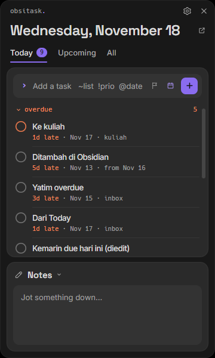
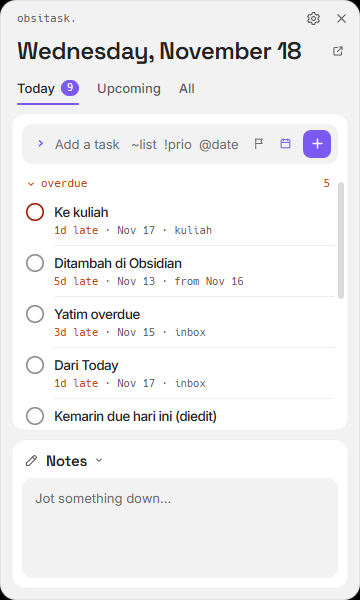

# ObsiTask

A small always-on-top desktop widget for Windows that shows the tasks in your Obsidian vault — today, overdue and upcoming — without opening Obsidian.

<p>
  
  
</p>

*Screenshots use sample data.* · [Bahasa Indonesia](docs/README.id.md)

## Features

- **Today**, **Upcoming** and **All** tabs: overdue tasks, tasks due today, the next days grouped by date (with a 7-day strip), and every list in your `Tasks.md`.
- Reads tasks from your **daily notes** and from one **list file** (`Tasks.md`). Your Markdown files stay the only source of data — no database, no extra files.
- **Quick add** with tokens: `!high`, `@tomorrow`, `~list`.
- Check off, edit, set priority and due date, move to another list, or delete (with undo) right from the widget. Changes are written back to the original line in the original file.
- **Notes** box that writes to the `## Notes` section of today's daily note.
- Picks up edits made in Obsidian within about two seconds.
- 16 color themes with light and dark variants, adjustable opacity and zoom, always-on-top.

## Requirements

- Windows 10 or 11 (WebView2 is included in current versions).
- An [Obsidian](https://obsidian.md) vault.
- Tasks written as Markdown checkboxes. Priorities and dates use the emoji format of the [Tasks plugin](https://publish.obsidian.md/tasks/) (`⏫` `🔼` `🔽`, `📅 2026-11-20`, `✅ 2026-11-18`). The plugin itself doesn't need to be installed.

## Install

1. Open the [Releases](https://github.com/Kekensya/obsitask/releases) page and download the latest `ObsiTask_x.y.z_x64-setup.exe` (or the `.msi`).
2. Run it.

**Windows SmartScreen:** the installer is not code-signed, so Windows may show *"Windows protected your PC"*. Click **More info → Run anyway**.

## First-time setup

On first start the widget asks for:

- **Obsidian vault folder** — use *Browse* to pick the folder that contains `.obsidian`.
- **Daily notes folder** and **date format** — filled in automatically from Obsidian's Daily notes settings when available (for example `Daily` and `YYYY-MM-DD`).

Everything else is in **Settings** (gear icon): vault paths, list file and default list, how many days to look back and ahead, theme, opacity, zoom and always-on-top. Changes apply immediately.

## Usage

**Tabs**

- **Today** — overdue tasks, tasks due today, and every task in today's daily note. Tasks completed today are in a collapsed *done today* group.
- **Upcoming** — tasks due in the next days (7 by default), grouped by date. Click a day in the strip to show only that day.
- **All** — every list in `Tasks.md`, each collapsible, with a *Completed* group at the bottom.

The icon next to the title opens today's daily note (or `Tasks.md` on the All tab) in Obsidian.

**Quick add**

Type in the *Add a task* bar and press Enter. New tasks go to your default list (`Inbox`) in `Tasks.md`; from the Today tab they get today's due date.

| Token | Meaning |
|---|---|
| `!high` `!med` `!low` | priority |
| `@today` `@tomorrow` `@2026-11-20` | due date |
| `~list` | target list (case-insensitive, a unique prefix is enough; typing `~` shows suggestions) |

Example: `Read chapter 3 ~school !high @tomorrow`

**Lists (`Tasks.md`)**

Every `## Heading` in `Tasks.md` is a list:

```markdown
## Inbox
- [ ] Buy notebook

## School
- [ ] Read chapter 3 ⏫ 📅 2026-11-20
  - [ ] Take notes
```

Create, rename or delete lists by editing the headings in Obsidian. The file and the default list's heading are created when needed.

**Editing tasks**

- Click the circle to complete a task (adds `✅ date`); click again to undo.
- Click a task's title to edit it (Enter saves, Esc cancels).
- Use the `⋯` button or right-click for priority, due date, *Move to list* and *Delete*.

**Notes**

The Notes card edits the content under `## Notes` in today's daily note and saves automatically. Drag the gap above it to resize it, or collapse it with the chevron.

## Credits

- Theme palettes (all themes except *Default*) are adapted from [Terax](https://github.com/crynta/terax-ai) by crynta (Apache License 2.0) and the original theme authors (Catppuccin, Dracula, Everforest, Gruvbox, Kanagawa, Nord, Rosé Pine, Solarized, Tokyo Night, and others). Only color values are used; no code was copied.
- Heading font: [Space Grotesk](https://github.com/floriankarsten/space-grotesk) by Florian Karsten, SIL Open Font License 1.1 (bundled in `src/fonts/` with its license).
- Built with [Tauri](https://tauri.app).

## License

[MIT](LICENSE) © 2026 Kekensya

## Development

Build from source (Rust + Tauri 2; the frontend is plain HTML/CSS/JS without a bundler):

```powershell
cargo install tauri-cli --version "^2"
cd src-tauri
cargo tauri dev      # run in development
cargo tauri build    # installers in src-tauri/target/release/bundle/
cargo test
```

How it works internally (file writes, polling and caching, themes, opacity, contrast audit, code layout) is described in [docs/DEVELOPMENT.md](docs/DEVELOPMENT.md). The color and contrast audit of every theme is in [docs/theme-contrast.md](docs/theme-contrast.md).
