# Audit warna dan kontras tema

Dibuat oleh skrip generator tema yang sama dengan yang menulis `src/themes.js`, jadi angka di sini
adalah warna yang benar-benar dipakai widget. Screenshot: tab Today, opacity 100%, 360×600, setelah perbaikan.

## Cara ukur

- **Kontras** = rasio WCAG 2.x, diukur di atas latar yang benar-benar dipakai: panel, kartu, kolom (bar tambah task,
  kotak Notes), popover. Batas: teks kecil **4.5:1**; teks besar dan elemen non-teks (lingkaran prioritas, garis
  tab, ikon +) **3:1**.
- **Urutan lapisan**: tema gelap panel < kartu < kolom < popover (makin terang); tema terang kartu paling terang,
  panel dan kolom sedikit lebih gelap. Selisih minimal: kartu vs panel 1.10:1 (gelap) / 1.07:1 (terang), kolom vs
  kartu 1.07:1.
- **Prioritas bisa dibedakan** = ΔE2000 antar ketiga warna ≥ 20 dalam penglihatan normal **dan** ≥ 12 dalam simulasi
  deuteranopia dan protanopia (Viénot 1999) — jadi tidak hanya mengandalkan rona merah/oranye.
- **Penyesuaian**: token yang gagal digeser terangnya (L\*) sesedikit mungkin sampai lolos; rona dipertahankan.
  Kolom "Penyesuaian" menunjukkan nilai sumber → nilai yang dipakai.
- **Sumber**: nilai Default dari spesifikasi ObsiTask; nilai tema lain dari file tema Terax
  (`src/modules/theme/themes/*.ts`). Semua 405 nilai yang diambil dicek ulang terhadap file sumbernya: tidak ada
  salah salin.

## Pemetaan token (tabel Fase C)

| Terax | ObsiTask |
|---|---|
| background | panel |
| card | kartu task / Notes, kartu tema di Settings |
| cardForeground | teks utama |
| mutedForeground | teks redup; teks samar = redup 85% di atas kartu |
| border | garis kartu / panel |
| secondary | kolom di dalam kartu (bar tambah task, kotak Notes) |
| accent | hover (tint di atas kartu) |
| primary / primaryForeground | aksen (checkbox selesai, garis tab, badge Today, tombol +, fokus) / teks di atasnya |
| destructive | overdue, toast error |
| terminal ansi[1] / ansi[3] / ansi[4] | prioritas high / medium / low |
| terminal ansi[6] | tag |

Pemeriksaan slot ANSI: di semua tema ansi[1] merah, ansi[3] oranye/kuning, ansi[4] biru/biru-hijau — sesuai.
Dua yang tampak janggal tapi memang begitu di sumbernya: Dracula ansi[4] = `#bd93f9` (ungu; "biru" versi Dracula),
dan Rosé Pine ansi[6] = rose (merah muda, dipakai untuk tag).

## Kesalahan yang ditemukan dan diperbaiki

- **Urutan lapisan terbalik.** Di 9 varian, `card` Terax lebih gelap dari `background` (Kanagawa gelap/terang,
  Kanagawa Dragon, Catppuccin gelap, Everforest gelap/terang, Dracula, Xcode terang, Solarized terang), jadi kartu
  tampak lebih gelap dari panel. Kedua nilai ditukar (panel = yang lebih gelap). Di beberapa varian lain kartu/kolom
  nyaris sama dengan panel; dinaikkan sampai selisih minimal di atas.
- **Popover tema Terax** dulu memakai warna kartu; sekarang satu tingkat di atas kolom (gelap) / sama dengan kartu (terang).
- **Hover**: `accent` Terax di Kanagawa Dragon dan Dracula terlalu jauh dari warna kartu untuk dipakai sebagai hover;
  diganti tint teks 5%.
- **Lingkaran tanpa prioritas** sekarang abu-abu netral (tanpa rona) 3:1 di atas kartu di semua tema.

## Ringkasan

| Tema | Varian | Panel | Kartu | Kolom | Popover | Urutan | Gagal (setelah penyesuaian) | Token disesuaikan |
|---|---|---|---|---|---|---|---|---|
| Default | gelap | `#181818` | `#2a2a2a` | `#333333` | `#3a3a3a` | ✓ | 0 | faint, ring, high |
| Default | terang | `#f2f2f2` | `#ffffff` | `#f2f2f2` | `#ffffff` | ✓ | 0 | primaryText, high |
| Xcode | gelap | `#1c1c1e` | `#2c2c2e` | `#3a3a3c` | `#404042` | ✓ | 0 | muted, faint, placeholder, primaryText, danger, primary |
| Xcode | terang | `#f5f5f7` | `#ffffff` | `#f0f0f2` | `#ffffff` | ✓ | 0 | background/card, muted, faint, placeholder, primaryText, danger, primary, medium |
| Claude | gelap | `#1f1e1d` | `#272725` | `#2d2c29` | `#33322f` | ✓ | 0 | card, secondary, primaryText, danger |
| Claude | terang | `#f8f7f3` | `#ffffff` | `#f0eee6` | `#ffffff` | ✓ | 0 | background, muted, faint, placeholder, primaryText, primary, high |
| Kanagawa | gelap | `#16161d` | `#1f1f28` | `#2a2a37` | `#30303c` | ✓ | 0 | background/card, faint, placeholder, danger |
| Kanagawa | terang | `#e5ddb0` | `#f2ecbc` | `#e5ddb0` | `#f2ecbc` | ✓ | 0 | background/card, muted, faint, placeholder, primaryText, danger, tag, high |
| Kanagawa Dragon | gelap | `#0d0c0c` | `#1a1818` | `#282727` | `#2e2d2d` | ✓ | 0 | background/card, card, accent (hover), danger, high |
| Tokyo Night | gelap | `#1a1b26` | `#222334` | `#292e42` | `#2e3348` | ✓ | 0 | card, faint, placeholder |
| Catppuccin | gelap | `#181825` | `#212131` | `#313244` | `#36384a` | ✓ | 0 | background/card, card, faint, placeholder |
| Catppuccin | terang | `#eff1f5` | `#ffffff` | `#e6e9ef` | `#ffffff` | ✓ | 0 | muted, faint, placeholder, primaryText, tag, medium |
| Rosé Pine | gelap | `#191724` | `#222031` | `#28253c` | `#2e2b42` | ✓ | 0 | card, secondary, muted, faint, placeholder |
| Rosé Pine | terang | `#f8f2eb` | `#fffaf3` | `#f2e9e1` | `#fffaf3` | ✓ | 0 | background, muted, faint, placeholder, primaryText, danger, tag, medium, onPrimary, primary |
| Everforest | gelap | `#272e33` | `#2d353b` | `#343f44` | `#3a4448` | ✓ | 0 | background/card, muted, faint, placeholder, danger, high |
| Everforest | terang | `#f2efd8` | `#fdf6e3` | `#efebd4` | `#fdf6e3` | ✓ | 0 | background/card, background, muted, faint, placeholder, primaryText, danger, tag, medium, primary, onPrimary |
| Nord | gelap | `#2e3440` | `#3b4252` | `#434c5e` | `#495263` | ✓ | 0 | muted, faint, placeholder, primaryText, danger, high |
| Nord | terang | `#eceff4` | `#ffffff` | `#e5e9f0` | `#ffffff` | ✓ | 0 | faint, placeholder, primaryText, danger, tag, medium, low, onPrimary, primary, high |
| Gruvbox | gelap | `#282828` | `#32302f` | `#3c3836` | `#423e3a` | ✓ | 0 | muted, faint, placeholder, danger, tag, high |
| Gruvbox | terang | `#f6ecc3` | `#f9f5d7` | `#ebdbb2` | `#f9f5d7` | ✓ | 0 | background, muted, faint, placeholder, primaryText, onPrimary, primary |
| Dracula | gelap | `#21222c` | `#282a36` | `#343746` | `#3a3d4b` | ✓ | 0 | background/card, accent (hover), faint, placeholder, danger |
| Solarized | gelap | `#002b36` | `#073642` | `#0d3b46` | `#14414b` | ✓ | 0 | secondary, text, muted, faint, placeholder, primaryText, danger, tag, high, onPrimary, medium |
| Solarized | terang | `#eee8d5` | `#fdf6e3` | `#eee8d5` | `#fdf6e3` | ✓ | 0 | background/card, text, muted, faint, placeholder, primaryText, danger, tag, medium, onPrimary, primary, high |
| Tide | gelap | `#14191c` | `#1d2327` | `#232c30` | `#293236` | ✓ | 0 | card, faint, placeholder, danger, high |
| Tide | terang | `#f2f6f5` | `#ffffff` | `#e3ecea` | `#ffffff` | ✓ | 0 | muted, faint, placeholder, primaryText, high |
| Sage | gelap | `#1c211e` | `#242a26` | `#2a322c` | `#303832` | ✓ | 0 | card, faint, placeholder, danger, high |
| Sage | terang | `#f4f6f0` | `#ffffff` | `#e6ecdd` | `#ffffff` | ✓ | 0 | muted, faint, placeholder, primaryText, tag, high |
| Caffeine | gelap | `#111111` | `#1c1c1c` | `#393028` | `#3e362e` | ✓ | 0 | card, danger |
| Caffeine | terang | `#f4f4f4` | `#fcfcfc` | `#ffdfb5` | `#fcfcfc` | ✓ | 0 | background, faint, placeholder, danger, tag, high |

## Default — gelap

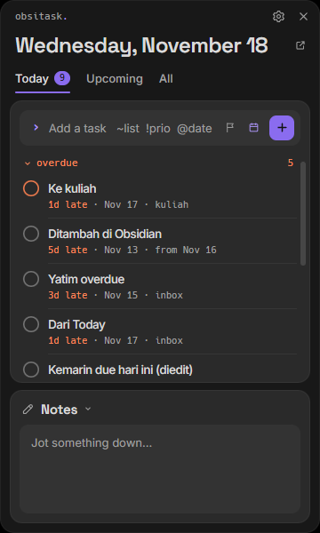

Lapisan: panel `#181818` · kartu `#2a2a2a` · kolom `#333333` · popover `#3a3a3a` — urutan benar.

| Pasangan | Depan / latar | Rasio | Batas | Hasil | Penyesuaian |
|---|---|---|---|---|---|
| Teks utama di kartu | `#dadada` / `#2a2a2a` | 10.27 | 4.5 | lulus | — |
| Teks utama di kolom | `#dadada` / `#333333` | 9.04 | 4.5 | lulus | — |
| Teks redup (muted) di kartu | `#a3a3a3` / `#2a2a2a` | 5.69 | 4.5 | lulus | — |
| Teks redup di kolom | `#a3a3a3` / `#333333` | 5.01 | 4.5 | lulus | — |
| Teks samar di kartu (Completed, tanggal, No tasks.) | `#9b9b9b` / `#2a2a2a` | 5.16 | 4.5 | lulus | faint: #949494 → #9b9b9b |
| Teks samar di kolom | `#9b9b9b` / `#333333` | 4.55 | 4.5 | lulus | faint: #949494 → #9b9b9b |
| Placeholder di kartu | `#a0a0a0` / `#2a2a2a` | 5.49 | 4.5 | lulus | — |
| Placeholder di kolom (bar tambah, Notes) | `#a0a0a0` / `#333333` | 4.83 | 4.5 | lulus | — |
| Judul di panel (teks besar) | `#dadada` / `#181818` | 12.70 | 3 | lulus | — |
| Tab tidak aktif di panel | `#a3a3a3` / `#181818` | 7.04 | 4.5 | lulus | — |
| Teks aksen di kartu (~list, ›) | `#ab94f7` / `#2a2a2a` | 5.68 | 4.5 | lulus | — |
| Teks aksen di kolom | `#ab94f7` / `#333333` | 5.00 | 4.5 | lulus | — |
| Teks/ikon di atas aksen (badge Today, tombol +) | `#121212` / `#8a6cef` | 4.88 | 4.5 | lulus | — |
| Aksen di panel (garis tab aktif) | `#8a6cef` / `#181818` | 4.63 | 3 | lulus | — |
| Aksen di kartu (+ di All, checkbox selesai) | `#8a6cef` / `#2a2a2a` | 3.74 | 3 | lulus | — |
| Overdue / "2d late" di kartu | `#ff8a5c` / `#2a2a2a` | 6.18 | 4.5 | lulus | — |
| Lingkaran high di kartu | `#ec7a4d` / `#2a2a2a` | 5.10 | 3 | lulus | high: #ff8a5c → #ec7a4d |
| Lingkaran medium di kartu | `#f2c14e` / `#2a2a2a` | 8.55 | 3 | lulus | — |
| Lingkaran low di kartu | `#5aa9ff` / `#2a2a2a` | 5.85 | 3 | lulus | — |
| Lingkaran tanpa prioritas di kartu | `#737373` / `#2a2a2a` | 3.03 | 3 | lulus | ring: #6e6e6e → #737373 |

Prioritas (ΔE2000 normal / deuteranopia / protanopia; batas 20 / 12 / 12):

| Pasangan | Normal | Deutan | Protan | Hasil |
|---|---|---|---|---|
| high–medium | 28.3 | 12 | 18.5 | lulus |
| high–low | 46.8 | 60.6 | 53.5 | lulus |
| medium–low | 53.2 | 66 | 61.6 | lulus |

Semua penyesuaian:

| Token | Sumber → dipakai | Alasan |
|---|---|---|
| faint | #949494 → #9b9b9b | faint text: 4.17 → 4.55 on card/well (needs 4.5) |
| ring | #6e6e6e → #737373 | no-priority circle: 2.81 → 3.03 on card (needs 3) |
| high | #ff8a5c → #ec7a4d | priority colors too similar (normal or red-green colour blindness): lightness shifted |

## Default — terang

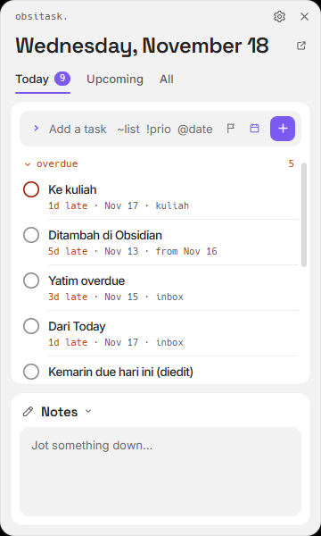

Lapisan: panel `#f2f2f2` · kartu `#ffffff` · kolom `#f2f2f2` · popover `#ffffff` — urutan benar.

| Pasangan | Depan / latar | Rasio | Batas | Hasil | Penyesuaian |
|---|---|---|---|---|---|
| Teks utama di kartu | `#222222` / `#ffffff` | 15.91 | 4.5 | lulus | — |
| Teks utama di kolom | `#222222` / `#f2f2f2` | 14.21 | 4.5 | lulus | — |
| Teks redup (muted) di kartu | `#5c5c5c` / `#ffffff` | 6.69 | 4.5 | lulus | — |
| Teks redup di kolom | `#5c5c5c` / `#f2f2f2` | 5.97 | 4.5 | lulus | — |
| Teks samar di kartu (Completed, tanggal, No tasks.) | `#6b6b6b` / `#ffffff` | 5.33 | 4.5 | lulus | — |
| Teks samar di kolom | `#6b6b6b` / `#f2f2f2` | 4.76 | 4.5 | lulus | — |
| Placeholder di kartu | `#6b6b6b` / `#ffffff` | 5.33 | 4.5 | lulus | — |
| Placeholder di kolom (bar tambah, Notes) | `#6b6b6b` / `#f2f2f2` | 4.76 | 4.5 | lulus | — |
| Judul di panel (teks besar) | `#222222` / `#f2f2f2` | 14.21 | 3 | lulus | — |
| Tab tidak aktif di panel | `#5c5c5c` / `#f2f2f2` | 5.97 | 4.5 | lulus | — |
| Teks aksen di kartu (~list, ›) | `#7254e9` / `#ffffff` | 5.05 | 4.5 | lulus | primaryText: #7a5af0 → #7254e9 |
| Teks aksen di kolom | `#7254e9` / `#f2f2f2` | 4.51 | 4.5 | lulus | primaryText: #7a5af0 → #7254e9 |
| Teks/ikon di atas aksen (badge Today, tombol +) | `#ffffff` / `#7a5af0` | 4.62 | 4.5 | lulus | — |
| Aksen di panel (garis tab aktif) | `#7a5af0` / `#f2f2f2` | 4.12 | 3 | lulus | — |
| Aksen di kartu (+ di All, checkbox selesai) | `#7a5af0` / `#ffffff` | 4.62 | 3 | lulus | — |
| Overdue / "2d late" di kartu | `#c2410c` / `#ffffff` | 5.18 | 4.5 | lulus | — |
| Lingkaran high di kartu | `#981900` / `#ffffff` | 8.49 | 3 | lulus | high: #c2410c → #981900 |
| Lingkaran medium di kartu | `#a16207` / `#ffffff` | 4.92 | 3 | lulus | — |
| Lingkaran low di kartu | `#1d4ed8` / `#ffffff` | 6.70 | 3 | lulus | — |
| Lingkaran tanpa prioritas di kartu | `#8a8a8a` / `#ffffff` | 3.45 | 3 | lulus | — |

Prioritas (ΔE2000 normal / deuteranopia / protanopia; batas 20 / 12 / 12):

| Pasangan | Normal | Deutan | Protan | Hasil |
|---|---|---|---|---|
| high–medium | 22.8 | 12.2 | 17.3 | lulus |
| high–low | 46.2 | 65.7 | 60.1 | lulus |
| medium–low | 55.2 | 70.7 | 66.8 | lulus |

Semua penyesuaian:

| Token | Sumber → dipakai | Alasan |
|---|---|---|
| primaryText | #7a5af0 → #7254e9 | accent text: 4.12 → 4.51 on card/well (needs 4.5) |
| high | #c2410c → #981900 | priority colors too similar (normal or red-green colour blindness): lightness shifted |

## Xcode — gelap

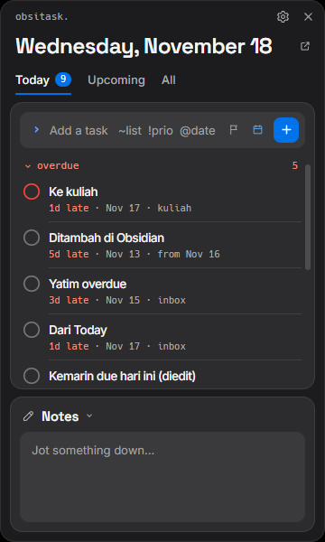

Lapisan: panel `#1c1c1e` · kartu `#2c2c2e` · kolom `#3a3a3c` · popover `#404042` — urutan benar.

| Pasangan | Depan / latar | Rasio | Batas | Hasil | Penyesuaian |
|---|---|---|---|---|---|
| Teks utama di kartu | `#f5f5f7` / `#2c2c2e` | 12.80 | 4.5 | lulus | — |
| Teks utama di kolom | `#f5f5f7` / `#3a3a3c` | 10.42 | 4.5 | lulus | — |
| Teks redup (muted) di kartu | `#ababb0` / `#2c2c2e` | 6.09 | 4.5 | lulus | muted: #98989d → #ababb0 |
| Teks redup di kolom | `#ababb0` / `#3a3a3c` | 4.96 | 4.5 | lulus | muted: #98989d → #ababb0 |
| Teks samar di kartu (Completed, tanggal, No tasks.) | `#a3a3a7` / `#2c2c2e` | 5.54 | 4.5 | lulus | faint: #88888c → #a3a3a7 |
| Teks samar di kolom | `#a3a3a7` / `#3a3a3c` | 4.51 | 4.5 | lulus | faint: #88888c → #a3a3a7 |
| Placeholder di kartu | `#a3a3a7` / `#2c2c2e` | 5.54 | 4.5 | lulus | placeholder: #88888c → #a3a3a7 |
| Placeholder di kolom (bar tambah, Notes) | `#a3a3a7` / `#3a3a3c` | 4.51 | 4.5 | lulus | placeholder: #88888c → #a3a3a7 |
| Judul di panel (teks besar) | `#f5f5f7` / `#1c1c1e` | 15.63 | 3 | lulus | — |
| Tab tidak aktif di panel | `#ababb0` / `#1c1c1e` | 7.44 | 4.5 | lulus | muted: #98989d → #ababb0 |
| Teks aksen di kartu (~list, ›) | `#5aa7ff` / `#2c2c2e` | 5.58 | 4.5 | lulus | primaryText: #0a84ff → #5aa7ff |
| Teks aksen di kolom | `#5aa7ff` / `#3a3a3c` | 4.54 | 4.5 | lulus | primaryText: #0a84ff → #5aa7ff |
| Teks/ikon di atas aksen (badge Today, tombol +) | `#ffffff` / `#0073eb` | 4.51 | 4.5 | lulus | — |
| Aksen di panel (garis tab aktif) | `#0073eb` / `#1c1c1e` | 3.77 | 3 | lulus | primary: #0a84ff → #0073eb |
| Aksen di kartu (+ di All, checkbox selesai) | `#0073eb` / `#2c2c2e` | 3.09 | 3 | lulus | primary: #0a84ff → #0073eb |
| Overdue / "2d late" di kartu | `#ff8b73` / `#2c2c2e` | 6.10 | 4.5 | lulus | danger: #ff453a → #ff8b73 |
| Lingkaran high di kartu | `#ff453a` / `#2c2c2e` | 4.09 | 3 | lulus | — |
| Lingkaran medium di kartu | `#ffd60a` / `#2c2c2e` | 9.87 | 3 | lulus | — |
| Lingkaran low di kartu | `#0a84ff` / `#2c2c2e` | 3.82 | 3 | lulus | — |
| Lingkaran tanpa prioritas di kartu | `#797979` / `#2c2c2e` | 3.20 | 3 | lulus | — |

Prioritas (ΔE2000 normal / deuteranopia / protanopia; batas 20 / 12 / 12):

| Pasangan | Normal | Deutan | Protan | Hasil |
|---|---|---|---|---|
| high–medium | 49.8 | 19.6 | 34.9 | lulus |
| high–low | 48.4 | 69.6 | 57.2 | lulus |
| medium–low | 68.8 | 80.5 | 76.4 | lulus |

Semua penyesuaian:

| Token | Sumber → dipakai | Alasan |
|---|---|---|
| muted | #98989d → #ababb0 | dim text: 3.60 → 4.52 on panel/card/well/pop (needs 4.5) |
| faint | #88888c → #a3a3a7 | faint text: 3.21 → 4.51 on card/well (needs 4.5) |
| placeholder | #88888c → #a3a3a7 | placeholder: 3.21 → 4.51 on card/well (needs 4.5) |
| primaryText | #0a84ff → #5aa7ff | accent text: 3.11 → 4.54 on card/well (needs 4.5) |
| danger | #ff453a → #ff8b73 | overdue text: 3.04 → 4.53 on card/pop (needs 4.5) |
| primary | #0a84ff → #0073eb | text on accent still below 4.5 with black/white text: accent shifted |

## Xcode — terang

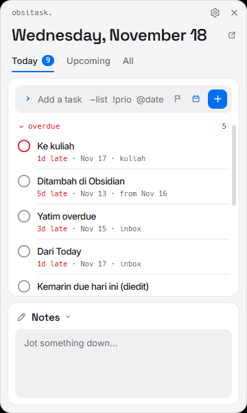

Lapisan: panel `#f5f5f7` · kartu `#ffffff` · kolom `#f0f0f2` · popover `#ffffff` — urutan benar.

| Pasangan | Depan / latar | Rasio | Batas | Hasil | Penyesuaian |
|---|---|---|---|---|---|
| Teks utama di kartu | `#1d1d1f` / `#ffffff` | 16.83 | 4.5 | lulus | — |
| Teks utama di kolom | `#1d1d1f` / `#f0f0f2` | 14.79 | 4.5 | lulus | — |
| Teks redup (muted) di kartu | `#6d6d72` / `#ffffff` | 5.15 | 4.5 | lulus | muted: #6e6e73 → #6d6d72 |
| Teks redup di kolom | `#6d6d72` / `#f0f0f2` | 4.52 | 4.5 | lulus | muted: #6e6e73 → #6d6d72 |
| Teks samar di kartu (Completed, tanggal, No tasks.) | `#6d6d71` / `#ffffff` | 5.15 | 4.5 | lulus | faint: #848488 → #6d6d71 |
| Teks samar di kolom | `#6d6d71` / `#f0f0f2` | 4.53 | 4.5 | lulus | faint: #848488 → #6d6d71 |
| Placeholder di kartu | `#6d6d71` / `#ffffff` | 5.15 | 4.5 | lulus | placeholder: #848488 → #6d6d71 |
| Placeholder di kolom (bar tambah, Notes) | `#6d6d71` / `#f0f0f2` | 4.53 | 4.5 | lulus | placeholder: #848488 → #6d6d71 |
| Judul di panel (teks besar) | `#1d1d1f` / `#f5f5f7` | 15.46 | 3 | lulus | — |
| Tab tidak aktif di panel | `#6d6d72` / `#f5f5f7` | 4.73 | 4.5 | lulus | muted: #6e6e73 → #6d6d72 |
| Teks aksen di kartu (~list, ›) | `#0066e7` / `#ffffff` | 5.18 | 4.5 | lulus | primaryText: #007aff → #0066e7 |
| Teks aksen di kolom | `#0066e7` / `#f0f0f2` | 4.55 | 4.5 | lulus | primaryText: #007aff → #0066e7 |
| Teks/ikon di atas aksen (badge Today, tombol +) | `#ffffff` / `#0070f3` | 4.55 | 4.5 | lulus | — |
| Aksen di panel (garis tab aktif) | `#0070f3` / `#f5f5f7` | 4.18 | 3 | lulus | primary: #007aff → #0070f3 |
| Aksen di kartu (+ di All, checkbox selesai) | `#0070f3` / `#ffffff` | 4.55 | 3 | lulus | primary: #007aff → #0070f3 |
| Overdue / "2d late" di kartu | `#e81e20` / `#ffffff` | 4.53 | 4.5 | lulus | danger: #ff3b30 → #e81e20 |
| Lingkaran high di kartu | `#d70015` / `#ffffff` | 5.38 | 3 | lulus | — |
| Lingkaran medium di kartu | `#df752d` / `#ffffff` | 3.12 | 3 | lulus | medium: #b25000 → #df752d |
| Lingkaran low di kartu | `#0040dd` / `#ffffff` | 7.56 | 3 | lulus | — |
| Lingkaran tanpa prioritas di kartu | `#8f8f8f` / `#ffffff` | 3.23 | 3 | lulus | — |

Prioritas (ΔE2000 normal / deuteranopia / protanopia; batas 20 / 12 / 12):

| Pasangan | Normal | Deutan | Protan | Hasil |
|---|---|---|---|---|
| high–medium | 21.9 | 12.3 | 21.5 | lulus |
| high–low | 46.7 | 73.5 | 60.6 | lulus |
| medium–low | 57.3 | 79.5 | 70.6 | lulus |

Semua penyesuaian:

| Token | Sumber → dipakai | Alasan |
|---|---|---|
| background/card | #ffffff / #f5f5f7 → #f5f5f7 / #ffffff | Terax card is darker than background: swapped so the card is the lightest layer |
| muted | #6e6e73 → #6d6d72 | dim text: 4.46 → 4.52 on panel/card/well/pop (needs 4.5) |
| faint | #848488 → #6d6d71 | faint text: 3.27 → 4.53 on card/well (needs 4.5) |
| placeholder | #848488 → #6d6d71 | placeholder: 3.27 → 4.53 on card/well (needs 4.5) |
| primaryText | #007aff → #0066e7 | accent text: 3.53 → 4.55 on card/well (needs 4.5) |
| danger | #ff3b30 → #e81e20 | overdue text: 3.55 → 4.53 on card/pop (needs 4.5) |
| primary | #007aff → #0070f3 | text on accent still below 4.5 with black/white text: accent shifted |
| medium | #b25000 → #df752d | priority colors too similar (normal or red-green colour blindness): lightness shifted |

## Claude — gelap

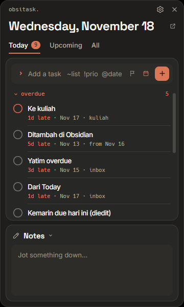

Lapisan: panel `#1f1e1d` · kartu `#272725` · kolom `#2d2c29` · popover `#33322f` — urutan benar.

| Pasangan | Depan / latar | Rasio | Batas | Hasil | Penyesuaian |
|---|---|---|---|---|---|
| Teks utama di kartu | `#f5f4ee` / `#272725` | 13.58 | 4.5 | lulus | — |
| Teks utama di kolom | `#f5f4ee` / `#2d2c29` | 12.67 | 4.5 | lulus | — |
| Teks redup (muted) di kartu | `#b0a89a` / `#272725` | 6.35 | 4.5 | lulus | — |
| Teks redup di kolom | `#b0a89a` / `#2d2c29` | 5.93 | 4.5 | lulus | — |
| Teks samar di kartu (Completed, tanggal, No tasks.) | `#9b9588` / `#272725` | 5.02 | 4.5 | lulus | — |
| Teks samar di kolom | `#9b9588` / `#2d2c29` | 4.69 | 4.5 | lulus | — |
| Placeholder di kartu | `#9b9588` / `#272725` | 5.02 | 4.5 | lulus | — |
| Placeholder di kolom (bar tambah, Notes) | `#9b9588` / `#2d2c29` | 4.69 | 4.5 | lulus | — |
| Judul di panel (teks besar) | `#f5f4ee` / `#1f1e1d` | 15.10 | 3 | lulus | — |
| Tab tidak aktif di panel | `#b0a89a` / `#1f1e1d` | 7.06 | 4.5 | lulus | — |
| Teks aksen di kartu (~list, ›) | `#da7858` / `#272725` | 4.85 | 4.5 | lulus | primaryText: #d97757 → #da7858 |
| Teks aksen di kolom | `#da7858` / `#2d2c29` | 4.53 | 4.5 | lulus | primaryText: #d97757 → #da7858 |
| Teks/ikon di atas aksen (badge Today, tombol +) | `#1f1e1d` / `#d97757` | 5.33 | 4.5 | lulus | — |
| Aksen di panel (garis tab aktif) | `#d97757` / `#1f1e1d` | 5.33 | 3 | lulus | — |
| Aksen di kartu (+ di All, checkbox selesai) | `#d97757` / `#272725` | 4.79 | 3 | lulus | — |
| Overdue / "2d late" di kartu | `#f5715a` / `#272725` | 5.27 | 4.5 | lulus | danger: #e5634d → #f5715a |
| Lingkaran high di kartu | `#e5634d` / `#272725` | 4.44 | 3 | lulus | — |
| Lingkaran medium di kartu | `#e8b87a` / `#272725` | 8.24 | 3 | lulus | — |
| Lingkaran low di kartu | `#8fb0d9` / `#272725` | 6.68 | 3 | lulus | — |
| Lingkaran tanpa prioritas di kartu | `#747474` / `#272725` | 3.20 | 3 | lulus | — |

Prioritas (ΔE2000 normal / deuteranopia / protanopia; batas 20 / 12 / 12):

| Pasangan | Normal | Deutan | Protan | Hasil |
|---|---|---|---|---|
| high–medium | 27.8 | 13.5 | 21.4 | lulus |
| high–low | 41.6 | 47 | 41.8 | lulus |
| medium–low | 37.5 | 46 | 41.8 | lulus |

Semua penyesuaian:

| Token | Sumber → dipakai | Alasan |
|---|---|---|
| card | #262624 → #272725 | card not visibly lighter than panel (needs 1.1:1) |
| secondary | #2a2926 → #2d2c29 | inner field not visibly lighter than card (needs 1.07:1) |
| primaryText | #d97757 → #da7858 | accent text: 4.47 → 4.53 on card/well (needs 4.5) |
| danger | #e5634d → #f5715a | overdue text: 3.80 → 4.51 on card/pop (needs 4.5) |

## Claude — terang

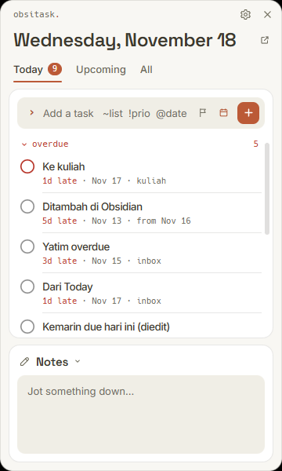

Lapisan: panel `#f8f7f3` · kartu `#ffffff` · kolom `#f0eee6` · popover `#ffffff` — urutan benar.

| Pasangan | Depan / latar | Rasio | Batas | Hasil | Penyesuaian |
|---|---|---|---|---|---|
| Teks utama di kartu | `#3d3a2f` / `#ffffff` | 11.38 | 4.5 | lulus | — |
| Teks utama di kolom | `#3d3a2f` / `#f0eee6` | 9.80 | 4.5 | lulus | — |
| Teks redup (muted) di kartu | `#6f6c5b` / `#ffffff` | 5.29 | 4.5 | lulus | muted: #73705f → #6f6c5b |
| Teks redup di kolom | `#6f6c5b` / `#f0eee6` | 4.55 | 4.5 | lulus | muted: #73705f → #6f6c5b |
| Teks samar di kartu (Completed, tanggal, No tasks.) | `#6f6c5f` / `#ffffff` | 5.27 | 4.5 | lulus | faint: #888577 → #6f6c5f |
| Teks samar di kolom | `#6f6c5f` / `#f0eee6` | 4.54 | 4.5 | lulus | faint: #888577 → #6f6c5f |
| Placeholder di kartu | `#6f6c5f` / `#ffffff` | 5.27 | 4.5 | lulus | placeholder: #888577 → #6f6c5f |
| Placeholder di kolom (bar tambah, Notes) | `#6f6c5f` / `#f0eee6` | 4.54 | 4.5 | lulus | placeholder: #888577 → #6f6c5f |
| Judul di panel (teks besar) | `#3d3a2f` / `#f8f7f3` | 10.62 | 3 | lulus | — |
| Tab tidak aktif di panel | `#6f6c5b` / `#f8f7f3` | 4.93 | 4.5 | lulus | muted: #73705f → #6f6c5b |
| Teks aksen di kartu (~list, ›) | `#af502e` / `#ffffff` | 5.24 | 4.5 | lulus | primaryText: #c15f3c → #af502e |
| Teks aksen di kolom | `#af502e` / `#f0eee6` | 4.51 | 4.5 | lulus | primaryText: #c15f3c → #af502e |
| Teks/ikon di atas aksen (badge Today, tombol +) | `#ffffff` / `#bb5a37` | 4.54 | 4.5 | lulus | — |
| Aksen di panel (garis tab aktif) | `#bb5a37` / `#f8f7f3` | 4.23 | 3 | lulus | primary: #c15f3c → #bb5a37 |
| Aksen di kartu (+ di All, checkbox selesai) | `#bb5a37` / `#ffffff` | 4.54 | 3 | lulus | primary: #c15f3c → #bb5a37 |
| Overdue / "2d late" di kartu | `#c0392b` / `#ffffff` | 5.44 | 4.5 | lulus | — |
| Lingkaran high di kartu | `#b52f23` / `#ffffff` | 6.18 | 3 | lulus | high: #c0392b → #b52f23 |
| Lingkaran medium di kartu | `#b07a2a` / `#ffffff` | 3.71 | 3 | lulus | — |
| Lingkaran low di kartu | `#3a6ea5` / `#ffffff` | 5.31 | 3 | lulus | — |
| Lingkaran tanpa prioritas di kartu | `#8f8f8f` / `#ffffff` | 3.23 | 3 | lulus | — |

Prioritas (ΔE2000 normal / deuteranopia / protanopia; batas 20 / 12 / 12):

| Pasangan | Normal | Deutan | Protan | Hasil |
|---|---|---|---|---|
| high–medium | 28.4 | 12.1 | 20.1 | lulus |
| high–low | 43.5 | 53.1 | 44 | lulus |
| medium–low | 45.3 | 56.6 | 51.2 | lulus |

Semua penyesuaian:

| Token | Sumber → dipakai | Alasan |
|---|---|---|
| background | #faf9f5 → #f8f7f3 | card not visibly lighter than panel (needs 1.07:1): panel darkened |
| muted | #73705f → #6f6c5b | dim text: 4.29 → 4.55 on panel/card/well/pop (needs 4.5) |
| faint | #888577 → #6f6c5f | faint text: 3.19 → 4.54 on card/well (needs 4.5) |
| placeholder | #888577 → #6f6c5f | placeholder: 3.19 → 4.54 on card/well (needs 4.5) |
| primaryText | #c15f3c → #af502e | accent text: 3.64 → 4.51 on card/well (needs 4.5) |
| primary | #c15f3c → #bb5a37 | text on accent still below 4.5 with black/white text: accent shifted |
| high | #c0392b → #b52f23 | priority colors too similar (normal or red-green colour blindness): lightness shifted |

## Kanagawa — gelap

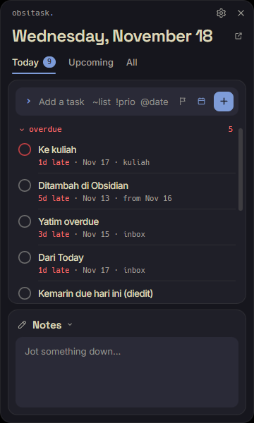

Lapisan: panel `#16161d` · kartu `#1f1f28` · kolom `#2a2a37` · popover `#30303c` — urutan benar.

| Pasangan | Depan / latar | Rasio | Batas | Hasil | Penyesuaian |
|---|---|---|---|---|---|
| Teks utama di kartu | `#dcd7ba` / `#1f1f28` | 11.26 | 4.5 | lulus | — |
| Teks utama di kolom | `#dcd7ba` / `#2a2a37` | 9.75 | 4.5 | lulus | — |
| Teks redup (muted) di kartu | `#a09f96` / `#1f1f28` | 6.14 | 4.5 | lulus | — |
| Teks redup di kolom | `#a09f96` / `#2a2a37` | 5.32 | 4.5 | lulus | — |
| Teks samar di kartu (Completed, tanggal, No tasks.) | `#93928c` / `#1f1f28` | 5.24 | 4.5 | lulus | faint: #8d8c86 → #93928c |
| Teks samar di kolom | `#93928c` / `#2a2a37` | 4.53 | 4.5 | lulus | faint: #8d8c86 → #93928c |
| Placeholder di kartu | `#93928c` / `#1f1f28` | 5.24 | 4.5 | lulus | placeholder: #8d8c86 → #93928c |
| Placeholder di kolom (bar tambah, Notes) | `#93928c` / `#2a2a37` | 4.53 | 4.5 | lulus | placeholder: #8d8c86 → #93928c |
| Judul di panel (teks besar) | `#dcd7ba` / `#16161d` | 12.41 | 3 | lulus | — |
| Tab tidak aktif di panel | `#a09f96` / `#16161d` | 6.77 | 4.5 | lulus | — |
| Teks aksen di kartu (~list, ›) | `#7e9cd8` / `#1f1f28` | 5.94 | 4.5 | lulus | — |
| Teks aksen di kolom | `#7e9cd8` / `#2a2a37` | 5.14 | 4.5 | lulus | — |
| Teks/ikon di atas aksen (badge Today, tombol +) | `#1f1f28` / `#7e9cd8` | 5.94 | 4.5 | lulus | — |
| Aksen di panel (garis tab aktif) | `#7e9cd8` / `#16161d` | 6.54 | 3 | lulus | — |
| Aksen di kartu (+ di All, checkbox selesai) | `#7e9cd8` / `#1f1f28` | 5.94 | 3 | lulus | — |
| Overdue / "2d late" di kartu | `#f56d6a` / `#1f1f28` | 5.66 | 4.5 | lulus | danger: #c34043 → #f56d6a |
| Lingkaran high di kartu | `#c34043` / `#1f1f28` | 3.22 | 3 | lulus | — |
| Lingkaran medium di kartu | `#c0a36e` / `#1f1f28` | 6.78 | 3 | lulus | — |
| Lingkaran low di kartu | `#7e9cd8` / `#1f1f28` | 5.94 | 3 | lulus | — |
| Lingkaran tanpa prioritas di kartu | `#6e6e6e` / `#1f1f28` | 3.21 | 3 | lulus | — |

Prioritas (ΔE2000 normal / deuteranopia / protanopia; batas 20 / 12 / 12):

| Pasangan | Normal | Deutan | Protan | Hasil |
|---|---|---|---|---|
| high–medium | 35.9 | 16.9 | 29.2 | lulus |
| high–low | 42.3 | 49.5 | 44.5 | lulus |
| medium–low | 39.9 | 47.9 | 44.9 | lulus |

Semua penyesuaian:

| Token | Sumber → dipakai | Alasan |
|---|---|---|
| background/card | #1f1f28 / #16161d → #16161d / #1f1f28 | Terax card is darker than background: swapped so the panel is the darkest layer |
| faint | #8d8c86 → #93928c | faint text: 4.19 → 4.53 on card/well (needs 4.5) |
| placeholder | #8d8c86 → #93928c | placeholder: 4.19 → 4.53 on card/well (needs 4.5) |
| danger | #c34043 → #f56d6a | overdue text: 2.56 → 4.51 on card/pop (needs 4.5) |

## Kanagawa — terang

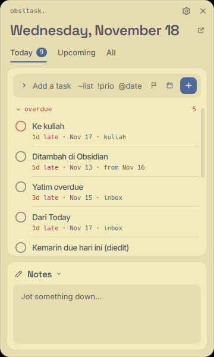

Lapisan: panel `#e5ddb0` · kartu `#f2ecbc` · kolom `#e5ddb0` · popover `#f2ecbc` — urutan benar.

| Pasangan | Depan / latar | Rasio | Batas | Hasil | Penyesuaian |
|---|---|---|---|---|---|
| Teks utama di kartu | `#545464` / `#f2ecbc` | 6.19 | 4.5 | lulus | — |
| Teks utama di kolom | `#545464` / `#e5ddb0` | 5.41 | 4.5 | lulus | — |
| Teks redup (muted) di kartu | `#626159` / `#f2ecbc` | 5.19 | 4.5 | lulus | muted: #8a8980 → #626159 |
| Teks redup di kolom | `#626159` / `#e5ddb0` | 4.54 | 4.5 | lulus | muted: #8a8980 → #626159 |
| Teks samar di kartu (Completed, tanggal, No tasks.) | `#636154` / `#f2ecbc` | 5.20 | 4.5 | lulus | faint: #9a9889 → #636154 |
| Teks samar di kolom | `#636154` / `#e5ddb0` | 4.54 | 4.5 | lulus | faint: #9a9889 → #636154 |
| Placeholder di kartu | `#636154` / `#f2ecbc` | 5.20 | 4.5 | lulus | placeholder: #9a9889 → #636154 |
| Placeholder di kolom (bar tambah, Notes) | `#636154` / `#e5ddb0` | 4.54 | 4.5 | lulus | placeholder: #9a9889 → #636154 |
| Judul di panel (teks besar) | `#545464` / `#e5ddb0` | 5.41 | 3 | lulus | — |
| Tab tidak aktif di panel | `#626159` / `#e5ddb0` | 4.54 | 4.5 | lulus | muted: #8a8980 → #626159 |
| Teks aksen di kartu (~list, ›) | `#446192` / `#f2ecbc` | 5.19 | 4.5 | lulus | primaryText: #4d699b → #446192 |
| Teks aksen di kolom | `#446192` / `#e5ddb0` | 4.54 | 4.5 | lulus | primaryText: #4d699b → #446192 |
| Teks/ikon di atas aksen (badge Today, tombol +) | `#f2ecbc` / `#4d699b` | 4.59 | 4.5 | lulus | — |
| Aksen di panel (garis tab aktif) | `#4d699b` / `#e5ddb0` | 4.02 | 3 | lulus | — |
| Aksen di kartu (+ di All, checkbox selesai) | `#4d699b` / `#f2ecbc` | 4.59 | 3 | lulus | — |
| Overdue / "2d late" di kartu | `#bf374c` / `#f2ecbc` | 4.53 | 4.5 | lulus | danger: #c84053 → #bf374c |
| Lingkaran high di kartu | `#e25867` / `#f2ecbc` | 3.00 | 3 | lulus | high: #c84053 → #e25867 |
| Lingkaran medium di kartu | `#77713f` / `#f2ecbc` | 4.15 | 3 | lulus | — |
| Lingkaran low di kartu | `#4d699b` / `#f2ecbc` | 4.59 | 3 | lulus | — |
| Lingkaran tanpa prioritas di kartu | `#828282` / `#f2ecbc` | 3.20 | 3 | lulus | — |

Prioritas (ΔE2000 normal / deuteranopia / protanopia; batas 20 / 12 / 12):

| Pasangan | Normal | Deutan | Protan | Hasil |
|---|---|---|---|---|
| high–medium | 40.4 | 12.1 | 12.8 | lulus |
| high–low | 38.8 | 45.9 | 28 | lulus |
| medium–low | 42.1 | 44.4 | 42.6 | lulus |

Semua penyesuaian:

| Token | Sumber → dipakai | Alasan |
|---|---|---|
| background/card | #f2ecbc / #e5ddb0 → #e5ddb0 / #f2ecbc | Terax card is darker than background: swapped so the card is the lightest layer |
| muted | #8a8980 → #626159 | dim text: 2.56 → 4.54 on panel/card/well/pop (needs 4.5) |
| faint | #9a9889 → #636154 | faint text: 2.12 → 4.54 on card/well (needs 4.5) |
| placeholder | #9a9889 → #636154 | placeholder: 2.12 → 4.54 on card/well (needs 4.5) |
| primaryText | #4d699b → #446192 | accent text: 4.02 → 4.54 on card/well (needs 4.5) |
| danger | #c84053 → #bf374c | overdue text: 4.06 → 4.53 on card/pop (needs 4.5) |
| tag | #597b75 → #4f706a | tag text: 3.88 → 4.54 on card (needs 4.5) |
| high | #c84053 → #e25867 | priority colors too similar (normal or red-green colour blindness): lightness shifted |

## Kanagawa Dragon — gelap

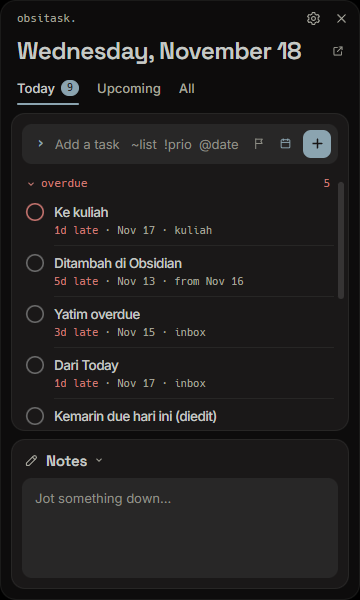

Lapisan: panel `#0d0c0c` · kartu `#1a1818` · kolom `#282727` · popover `#2e2d2d` — urutan benar.

| Pasangan | Depan / latar | Rasio | Batas | Hasil | Penyesuaian |
|---|---|---|---|---|---|
| Teks utama di kartu | `#c5c9c5` / `#1a1818` | 10.55 | 4.5 | lulus | — |
| Teks utama di kolom | `#c5c9c5` / `#282727` | 8.89 | 4.5 | lulus | — |
| Teks redup (muted) di kartu | `#a6a69c` / `#1a1818` | 7.20 | 4.5 | lulus | — |
| Teks redup di kolom | `#a6a69c` / `#282727` | 6.07 | 4.5 | lulus | — |
| Teks samar di kartu (Completed, tanggal, No tasks.) | `#919188` / `#1a1818` | 5.56 | 4.5 | lulus | — |
| Teks samar di kolom | `#919188` / `#282727` | 4.69 | 4.5 | lulus | — |
| Placeholder di kartu | `#919188` / `#1a1818` | 5.56 | 4.5 | lulus | — |
| Placeholder di kolom (bar tambah, Notes) | `#919188` / `#282727` | 4.69 | 4.5 | lulus | — |
| Judul di panel (teks besar) | `#c5c9c5` / `#0d0c0c` | 11.66 | 3 | lulus | — |
| Tab tidak aktif di panel | `#a6a69c` / `#0d0c0c` | 7.96 | 4.5 | lulus | — |
| Teks aksen di kartu (~list, ›) | `#8ba4b0` / `#1a1818` | 6.76 | 4.5 | lulus | — |
| Teks aksen di kolom | `#8ba4b0` / `#282727` | 5.70 | 4.5 | lulus | — |
| Teks/ikon di atas aksen (badge Today, tombol +) | `#181616` / `#8ba4b0` | 6.90 | 4.5 | lulus | — |
| Aksen di panel (garis tab aktif) | `#8ba4b0` / `#0d0c0c` | 7.47 | 3 | lulus | — |
| Aksen di kartu (+ di All, checkbox selesai) | `#8ba4b0` / `#1a1818` | 6.76 | 3 | lulus | — |
| Overdue / "2d late" di kartu | `#cf7e77` / `#1a1818` | 5.81 | 4.5 | lulus | danger: #c4746e → #cf7e77 |
| Lingkaran high di kartu | `#c1716c` / `#1a1818` | 4.92 | 3 | lulus | high: #c4746e → #c1716c |
| Lingkaran medium di kartu | `#c4b28a` / `#1a1818` | 8.49 | 3 | lulus | — |
| Lingkaran low di kartu | `#8ba4b0` / `#1a1818` | 6.76 | 3 | lulus | — |
| Lingkaran tanpa prioritas di kartu | `#696969` / `#1a1818` | 3.22 | 3 | lulus | — |

Prioritas (ΔE2000 normal / deuteranopia / protanopia; batas 20 / 12 / 12):

| Pasangan | Normal | Deutan | Protan | Hasil |
|---|---|---|---|---|
| high–medium | 28.1 | 12.6 | 18.9 | lulus |
| high–low | 35.5 | 27.3 | 21.4 | lulus |
| medium–low | 24.8 | 29.2 | 25.5 | lulus |

Semua penyesuaian:

| Token | Sumber → dipakai | Alasan |
|---|---|---|
| background/card | #181616 / #0d0c0c → #0d0c0c / #181616 | Terax card is darker than background: swapped so the panel is the darkest layer |
| card | #181616 → #1a1818 | card not visibly lighter than panel (needs 1.1:1) |
| accent (hover) | #393836 → rgba(197, 201, 197, 0.05) | accent too far from card for a hover |
| danger | #c4746e → #cf7e77 | overdue text: 3.97 → 4.51 on card/pop (needs 4.5) |
| high | #c4746e → #c1716c | priority colors too similar (normal or red-green colour blindness): lightness shifted |

## Tokyo Night — gelap

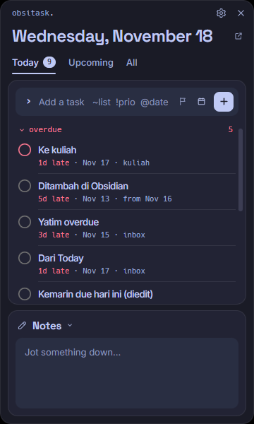

Lapisan: panel `#1a1b26` · kartu `#222334` · kolom `#292e42` · popover `#2e3348` — urutan benar.

| Pasangan | Depan / latar | Rasio | Batas | Hasil | Penyesuaian |
|---|---|---|---|---|---|
| Teks utama di kartu | `#c0caf5` / `#222334` | 9.58 | 4.5 | lulus | — |
| Teks utama di kolom | `#c0caf5` / `#292e42` | 8.32 | 4.5 | lulus | — |
| Teks redup (muted) di kartu | `#9aa5ce` / `#222334` | 6.37 | 4.5 | lulus | — |
| Teks redup di kolom | `#9aa5ce` / `#292e42` | 5.53 | 4.5 | lulus | — |
| Teks samar di kartu (Completed, tanggal, No tasks.) | `#8b95ba` / `#222334` | 5.23 | 4.5 | lulus | faint: #8892b7 → #8b95ba |
| Teks samar di kolom | `#8b95ba` / `#292e42` | 4.54 | 4.5 | lulus | faint: #8892b7 → #8b95ba |
| Placeholder di kartu | `#8b95ba` / `#222334` | 5.23 | 4.5 | lulus | placeholder: #8892b7 → #8b95ba |
| Placeholder di kolom (bar tambah, Notes) | `#8b95ba` / `#292e42` | 4.54 | 4.5 | lulus | placeholder: #8892b7 → #8b95ba |
| Judul di panel (teks besar) | `#c0caf5` / `#1a1b26` | 10.59 | 3 | lulus | — |
| Tab tidak aktif di panel | `#9aa5ce` / `#1a1b26` | 7.04 | 4.5 | lulus | — |
| Teks aksen di kartu (~list, ›) | `#c0caf5` / `#222334` | 9.58 | 4.5 | lulus | — |
| Teks aksen di kolom | `#c0caf5` / `#292e42` | 8.32 | 4.5 | lulus | — |
| Teks/ikon di atas aksen (badge Today, tombol +) | `#1a1b26` / `#c0caf5` | 10.59 | 4.5 | lulus | — |
| Aksen di panel (garis tab aktif) | `#c0caf5` / `#1a1b26` | 10.59 | 3 | lulus | — |
| Aksen di kartu (+ di All, checkbox selesai) | `#c0caf5` / `#222334` | 9.58 | 3 | lulus | — |
| Overdue / "2d late" di kartu | `#f7768e` / `#222334` | 5.84 | 4.5 | lulus | — |
| Lingkaran high di kartu | `#f7768e` / `#222334` | 5.84 | 3 | lulus | — |
| Lingkaran medium di kartu | `#e0af68` / `#222334` | 7.73 | 3 | lulus | — |
| Lingkaran low di kartu | `#7aa2f7` / `#222334` | 6.14 | 3 | lulus | — |
| Lingkaran tanpa prioritas di kartu | `#727272` / `#222334` | 3.21 | 3 | lulus | — |

Prioritas (ΔE2000 normal / deuteranopia / protanopia; batas 20 / 12 / 12):

| Pasangan | Normal | Deutan | Protan | Hasil |
|---|---|---|---|---|
| high–medium | 35.7 | 13.2 | 25.8 | lulus |
| high–low | 37.5 | 43 | 24 | lulus |
| medium–low | 47.2 | 58.5 | 54.6 | lulus |

Semua penyesuaian:

| Token | Sumber → dipakai | Alasan |
|---|---|---|
| card | #1f2030 → #222334 | card not visibly lighter than panel (needs 1.1:1) |
| faint | #8892b7 → #8b95ba | faint text: 4.38 → 4.54 on card/well (needs 4.5) |
| placeholder | #8892b7 → #8b95ba | placeholder: 4.38 → 4.54 on card/well (needs 4.5) |

## Catppuccin — gelap

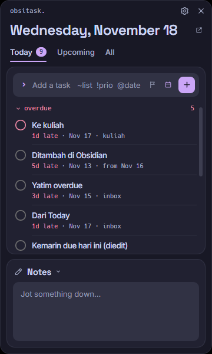

Lapisan: panel `#181825` · kartu `#212131` · kolom `#313244` · popover `#36384a` — urutan benar.

| Pasangan | Depan / latar | Rasio | Batas | Hasil | Penyesuaian |
|---|---|---|---|---|---|
| Teks utama di kartu | `#cdd6f4` / `#212131` | 10.95 | 4.5 | lulus | — |
| Teks utama di kolom | `#cdd6f4` / `#313244` | 8.69 | 4.5 | lulus | — |
| Teks redup (muted) di kartu | `#a6adc8` / `#212131` | 7.11 | 4.5 | lulus | — |
| Teks redup di kolom | `#a6adc8` / `#313244` | 5.65 | 4.5 | lulus | — |
| Teks samar di kartu (Completed, tanggal, No tasks.) | `#949ab3` / `#212131` | 5.68 | 4.5 | lulus | faint: #9298b1 → #949ab3 |
| Teks samar di kolom | `#949ab3` / `#313244` | 4.51 | 4.5 | lulus | faint: #9298b1 → #949ab3 |
| Placeholder di kartu | `#949ab3` / `#212131` | 5.68 | 4.5 | lulus | placeholder: #9298b1 → #949ab3 |
| Placeholder di kolom (bar tambah, Notes) | `#949ab3` / `#313244` | 4.51 | 4.5 | lulus | placeholder: #9298b1 → #949ab3 |
| Judul di panel (teks besar) | `#cdd6f4` / `#181825` | 12.14 | 3 | lulus | — |
| Tab tidak aktif di panel | `#a6adc8` / `#181825` | 7.89 | 4.5 | lulus | — |
| Teks aksen di kartu (~list, ›) | `#cba6f7` / `#212131` | 7.79 | 4.5 | lulus | — |
| Teks aksen di kolom | `#cba6f7` / `#313244` | 6.19 | 4.5 | lulus | — |
| Teks/ikon di atas aksen (badge Today, tombol +) | `#1e1e2e` / `#cba6f7` | 8.07 | 4.5 | lulus | — |
| Aksen di panel (garis tab aktif) | `#cba6f7` / `#181825` | 8.64 | 3 | lulus | — |
| Aksen di kartu (+ di All, checkbox selesai) | `#cba6f7` / `#212131` | 7.79 | 3 | lulus | — |
| Overdue / "2d late" di kartu | `#f38ba8` / `#212131` | 6.84 | 4.5 | lulus | — |
| Lingkaran high di kartu | `#f38ba8` / `#212131` | 6.84 | 3 | lulus | — |
| Lingkaran medium di kartu | `#f9e2af` / `#212131` | 12.46 | 3 | lulus | — |
| Lingkaran low di kartu | `#89b4fa` / `#212131` | 7.52 | 3 | lulus | — |
| Lingkaran tanpa prioritas di kartu | `#717171` / `#212131` | 3.24 | 3 | lulus | — |

Prioritas (ΔE2000 normal / deuteranopia / protanopia; batas 20 / 12 / 12):

| Pasangan | Normal | Deutan | Protan | Hasil |
|---|---|---|---|---|
| high–medium | 38.4 | 18.3 | 32.1 | lulus |
| high–low | 35.6 | 31.6 | 17.6 | lulus |
| medium–low | 42.2 | 50 | 46.7 | lulus |

Semua penyesuaian:

| Token | Sumber → dipakai | Alasan |
|---|---|---|
| background/card | #1e1e2e / #181825 → #181825 / #1e1e2e | Terax card is darker than background: swapped so the panel is the darkest layer |
| card | #1e1e2e → #212131 | card not visibly lighter than panel (needs 1.1:1) |
| faint | #9298b1 → #949ab3 | faint text: 4.40 → 4.51 on card/well (needs 4.5) |
| placeholder | #9298b1 → #949ab3 | placeholder: 4.40 → 4.51 on card/well (needs 4.5) |

## Catppuccin — terang

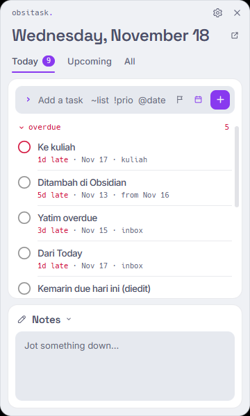

Lapisan: panel `#eff1f5` · kartu `#ffffff` · kolom `#e6e9ef` · popover `#ffffff` — urutan benar.

| Pasangan | Depan / latar | Rasio | Batas | Hasil | Penyesuaian |
|---|---|---|---|---|---|
| Teks utama di kartu | `#4c4f69` / `#ffffff` | 7.99 | 4.5 | lulus | — |
| Teks utama di kolom | `#4c4f69` / `#e6e9ef` | 6.57 | 4.5 | lulus | — |
| Teks redup (muted) di kartu | `#65687e` / `#ffffff` | 5.48 | 4.5 | lulus | muted: #6c6f85 → #65687e |
| Teks redup di kolom | `#65687e` / `#e6e9ef` | 4.50 | 4.5 | lulus | muted: #6c6f85 → #65687e |
| Teks samar di kartu (Completed, tanggal, No tasks.) | `#656879` / `#ffffff` | 5.51 | 4.5 | lulus | faint: #828597 → #656879 |
| Teks samar di kolom | `#656879` / `#e6e9ef` | 4.53 | 4.5 | lulus | faint: #828597 → #656879 |
| Placeholder di kartu | `#656879` / `#ffffff` | 5.51 | 4.5 | lulus | placeholder: #828597 → #656879 |
| Placeholder di kolom (bar tambah, Notes) | `#656879` / `#e6e9ef` | 4.53 | 4.5 | lulus | placeholder: #828597 → #656879 |
| Judul di panel (teks besar) | `#4c4f69` / `#eff1f5` | 7.06 | 3 | lulus | — |
| Tab tidak aktif di panel | `#65687e` / `#eff1f5` | 4.84 | 4.5 | lulus | muted: #6c6f85 → #65687e |
| Teks aksen di kartu (~list, ›) | `#8738ee` / `#ffffff` | 5.48 | 4.5 | lulus | primaryText: #8839ef → #8738ee |
| Teks aksen di kolom | `#8738ee` / `#e6e9ef` | 4.51 | 4.5 | lulus | primaryText: #8839ef → #8738ee |
| Teks/ikon di atas aksen (badge Today, tombol +) | `#eff1f5` / `#8839ef` | 4.79 | 4.5 | lulus | — |
| Aksen di panel (garis tab aktif) | `#8839ef` / `#eff1f5` | 4.79 | 3 | lulus | — |
| Aksen di kartu (+ di All, checkbox selesai) | `#8839ef` / `#ffffff` | 5.41 | 3 | lulus | — |
| Overdue / "2d late" di kartu | `#d20f39` / `#ffffff` | 5.43 | 4.5 | lulus | — |
| Lingkaran high di kartu | `#d20f39` / `#ffffff` | 5.43 | 3 | lulus | — |
| Lingkaran medium di kartu | `#d2830b` / `#ffffff` | 3.00 | 3 | lulus | medium: #df8e1d → #d2830b |
| Lingkaran low di kartu | `#1e66f5` / `#ffffff` | 4.91 | 3 | lulus | — |
| Lingkaran tanpa prioritas di kartu | `#8f8f8f` / `#ffffff` | 3.23 | 3 | lulus | — |

Prioritas (ΔE2000 normal / deuteranopia / protanopia; batas 20 / 12 / 12):

| Pasangan | Normal | Deutan | Protan | Hasil |
|---|---|---|---|---|
| high–medium | 36.8 | 15.3 | 29.8 | lulus |
| high–low | 42.8 | 65.2 | 47.4 | lulus |
| medium–low | 59 | 75.9 | 71.2 | lulus |

Semua penyesuaian:

| Token | Sumber → dipakai | Alasan |
|---|---|---|
| muted | #6c6f85 → #65687e | dim text: 4.06 → 4.50 on panel/card/well/pop (needs 4.5) |
| faint | #828597 → #656879 | faint text: 3.00 → 4.53 on card/well (needs 4.5) |
| placeholder | #828597 → #656879 | placeholder: 3.00 → 4.53 on card/well (needs 4.5) |
| primaryText | #8839ef → #8738ee | accent text: 4.45 → 4.51 on card/well (needs 4.5) |
| tag | #179299 → #00838a | tag text: 3.74 → 4.55 on card (needs 4.5) |
| medium | #df8e1d → #d2830b | medium circle: 2.62 → 3.00 on card (needs 3) |

## Rosé Pine — gelap

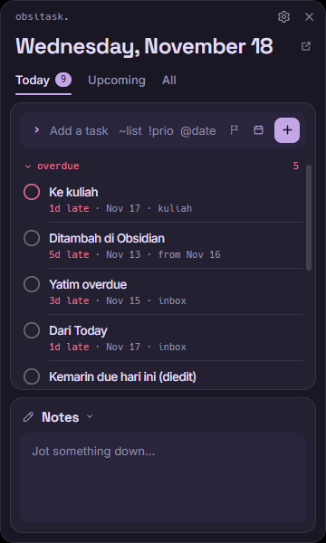

Lapisan: panel `#191724` · kartu `#222031` · kolom `#28253c` · popover `#2e2b42` — urutan benar.

| Pasangan | Depan / latar | Rasio | Batas | Hasil | Penyesuaian |
|---|---|---|---|---|---|
| Teks utama di kartu | `#e0def4` / `#222031` | 12.07 | 4.5 | lulus | — |
| Teks utama di kolom | `#e0def4` / `#28253c` | 11.21 | 4.5 | lulus | — |
| Teks redup (muted) di kartu | `#9591af` / `#222031` | 5.27 | 4.5 | lulus | muted: #908caa → #9591af |
| Teks redup di kolom | `#9591af` / `#28253c` | 4.89 | 4.5 | lulus | muted: #908caa → #9591af |
| Teks samar di kartu (Completed, tanggal, No tasks.) | `#8e8ba7` / `#222031` | 4.85 | 4.5 | lulus | faint: #7f7c98 → #8e8ba7 |
| Teks samar di kolom | `#8e8ba7` / `#28253c` | 4.51 | 4.5 | lulus | faint: #7f7c98 → #8e8ba7 |
| Placeholder di kartu | `#8e8ba7` / `#222031` | 4.85 | 4.5 | lulus | placeholder: #7f7c98 → #8e8ba7 |
| Placeholder di kolom (bar tambah, Notes) | `#8e8ba7` / `#28253c` | 4.51 | 4.5 | lulus | placeholder: #7f7c98 → #8e8ba7 |
| Judul di panel (teks besar) | `#e0def4` / `#191724` | 13.39 | 3 | lulus | — |
| Tab tidak aktif di panel | `#9591af` / `#191724` | 5.84 | 4.5 | lulus | muted: #908caa → #9591af |
| Teks aksen di kartu (~list, ›) | `#c4a7e7` / `#222031` | 7.60 | 4.5 | lulus | — |
| Teks aksen di kolom | `#c4a7e7` / `#28253c` | 7.06 | 4.5 | lulus | — |
| Teks/ikon di atas aksen (badge Today, tombol +) | `#191724` / `#c4a7e7` | 8.43 | 4.5 | lulus | — |
| Aksen di panel (garis tab aktif) | `#c4a7e7` / `#191724` | 8.43 | 3 | lulus | — |
| Aksen di kartu (+ di All, checkbox selesai) | `#c4a7e7` / `#222031` | 7.60 | 3 | lulus | — |
| Overdue / "2d late" di kartu | `#eb6f92` / `#222031` | 5.47 | 4.5 | lulus | — |
| Lingkaran high di kartu | `#eb6f92` / `#222031` | 5.47 | 3 | lulus | — |
| Lingkaran medium di kartu | `#f6c177` / `#222031` | 9.71 | 3 | lulus | — |
| Lingkaran low di kartu | `#9ccfd8` / `#222031` | 9.35 | 3 | lulus | — |
| Lingkaran tanpa prioritas di kartu | `#707070` / `#222031` | 3.22 | 3 | lulus | — |

Prioritas (ΔE2000 normal / deuteranopia / protanopia; batas 20 / 12 / 12):

| Pasangan | Normal | Deutan | Protan | Hasil |
|---|---|---|---|---|
| high–medium | 40.3 | 20.8 | 36.6 | lulus |
| high–low | 44 | 22.9 | 20.2 | lulus |
| medium–low | 34 | 37.2 | 31.1 | lulus |

Semua penyesuaian:

| Token | Sumber → dipakai | Alasan |
|---|---|---|
| card | #1f1d2e → #222031 | card not visibly lighter than panel (needs 1.1:1) |
| secondary | #26233a → #28253c | inner field not visibly lighter than card (needs 1.07:1) |
| muted | #908caa → #9591af | dim text: 4.23 → 4.51 on panel/card/well/pop (needs 4.5) |
| faint | #7f7c98 → #8e8ba7 | faint text: 3.69 → 4.51 on card/well (needs 4.5) |
| placeholder | #7f7c98 → #8e8ba7 | placeholder: 3.69 → 4.51 on card/well (needs 4.5) |

## Rosé Pine — terang

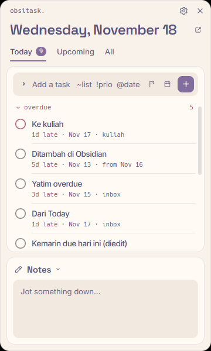

Lapisan: panel `#f8f2eb` · kartu `#fffaf3` · kolom `#f2e9e1` · popover `#fffaf3` — urutan benar.

| Pasangan | Depan / latar | Rasio | Batas | Hasil | Penyesuaian |
|---|---|---|---|---|---|
| Teks utama di kartu | `#575279` / `#fffaf3` | 7.00 | 4.5 | lulus | — |
| Teks utama di kolom | `#575279` / `#f2e9e1` | 6.07 | 4.5 | lulus | — |
| Teks redup (muted) di kartu | `#6a6683` / `#fffaf3` | 5.26 | 4.5 | lulus | muted: #797593 → #6a6683 |
| Teks redup di kolom | `#6a6683` / `#f2e9e1` | 4.56 | 4.5 | lulus | muted: #797593 → #6a6683 |
| Teks samar di kartu (Completed, tanggal, No tasks.) | `#6b677e` / `#fffaf3` | 5.23 | 4.5 | lulus | faint: #8d89a1 → #6b677e |
| Teks samar di kolom | `#6b677e` / `#f2e9e1` | 4.53 | 4.5 | lulus | faint: #8d89a1 → #6b677e |
| Placeholder di kartu | `#6b677e` / `#fffaf3` | 5.23 | 4.5 | lulus | placeholder: #8d89a1 → #6b677e |
| Placeholder di kolom (bar tambah, Notes) | `#6b677e` / `#f2e9e1` | 4.53 | 4.5 | lulus | placeholder: #8d89a1 → #6b677e |
| Judul di panel (teks besar) | `#575279` / `#f8f2eb` | 6.54 | 3 | lulus | — |
| Tab tidak aktif di panel | `#6a6683` / `#f8f2eb` | 4.92 | 4.5 | lulus | muted: #797593 → #6a6683 |
| Teks aksen di kartu (~list, ›) | `#76618e` / `#fffaf3` | 5.22 | 4.5 | lulus | primaryText: #907aa9 → #76618e |
| Teks aksen di kolom | `#76618e` / `#f2e9e1` | 4.53 | 4.5 | lulus | primaryText: #907aa9 → #76618e |
| Teks/ikon di atas aksen (badge Today, tombol +) | `#ffffff` / `#836d9c` | 4.53 | 4.5 | lulus | onPrimary: #faf4ed → #ffffff |
| Aksen di panel (garis tab aktif) | `#836d9c` / `#f8f2eb` | 4.08 | 3 | lulus | primary: #907aa9 → #836d9c |
| Aksen di kartu (+ di All, checkbox selesai) | `#836d9c` / `#fffaf3` | 4.36 | 3 | lulus | primary: #907aa9 → #836d9c |
| Overdue / "2d late" di kartu | `#ab5b72` / `#fffaf3` | 4.52 | 4.5 | lulus | danger: #b4637a → #ab5b72 |
| Lingkaran high di kartu | `#b4637a` / `#fffaf3` | 4.04 | 3 | lulus | — |
| Lingkaran medium di kartu | `#ca8214` / `#fffaf3` | 3.01 | 3 | lulus | medium: #ea9d34 → #ca8214 |
| Lingkaran low di kartu | `#56949f` / `#fffaf3` | 3.30 | 3 | lulus | — |
| Lingkaran tanpa prioritas di kartu | `#8c8c8c` / `#fffaf3` | 3.24 | 3 | lulus | — |

Prioritas (ΔE2000 normal / deuteranopia / protanopia; batas 20 / 12 / 12):

| Pasangan | Normal | Deutan | Protan | Hasil |
|---|---|---|---|---|
| high–medium | 37.4 | 24.6 | 34.4 | lulus |
| high–low | 44.3 | 18.7 | 12 | lulus |
| medium–low | 40.1 | 43.5 | 36.4 | lulus |

Semua penyesuaian:

| Token | Sumber → dipakai | Alasan |
|---|---|---|
| background | #faf4ed → #f8f2eb | card not visibly lighter than panel (needs 1.07:1): panel darkened |
| muted | #797593 → #6a6683 | dim text: 3.67 → 4.56 on panel/card/well/pop (needs 4.5) |
| faint | #8d89a1 → #6b677e | faint text: 2.81 → 4.53 on card/well (needs 4.5) |
| placeholder | #8d89a1 → #6b677e | placeholder: 2.81 → 4.53 on card/well (needs 4.5) |
| primaryText | #907aa9 → #76618e | accent text: 3.16 → 4.53 on card/well (needs 4.5) |
| danger | #b4637a → #ab5b72 | overdue text: 4.04 → 4.52 on card/pop (needs 4.5) |
| tag | #d7827e → #ad5d5a | tag text: 2.74 → 4.50 on card (needs 4.5) |
| medium | #ea9d34 → #ca8214 | medium circle: 2.16 → 3.01 on card (needs 3) |
| onPrimary | #faf4ed → #ffffff | text on accent: 3.47 → 4.53 (needs 4.5) |
| primary | #907aa9 → #836d9c | text on accent still below 4.5 with black/white text: accent shifted |

## Everforest — gelap

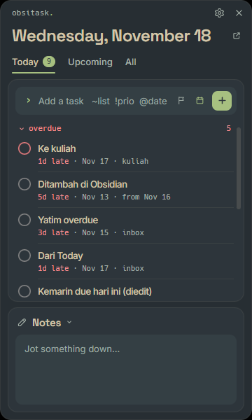

Lapisan: panel `#272e33` · kartu `#2d353b` · kolom `#343f44` · popover `#3a4448` — urutan benar.

| Pasangan | Depan / latar | Rasio | Batas | Hasil | Penyesuaian |
|---|---|---|---|---|---|
| Teks utama di kartu | `#d3c6aa` / `#2d353b` | 7.38 | 4.5 | lulus | — |
| Teks utama di kolom | `#d3c6aa` / `#343f44` | 6.40 | 4.5 | lulus | — |
| Teks redup (muted) di kartu | `#a5b1a8` / `#2d353b` | 5.61 | 4.5 | lulus | muted: #9da9a0 → #a5b1a8 |
| Teks redup di kolom | `#a5b1a8` / `#343f44` | 4.87 | 4.5 | lulus | muted: #9da9a0 → #a5b1a8 |
| Teks samar di kartu (Completed, tanggal, No tasks.) | `#9eaaa3` / `#2d353b` | 5.19 | 4.5 | lulus | faint: #8c9891 → #9eaaa3 |
| Teks samar di kolom | `#9eaaa3` / `#343f44` | 4.50 | 4.5 | lulus | faint: #8c9891 → #9eaaa3 |
| Placeholder di kartu | `#9eaaa3` / `#2d353b` | 5.19 | 4.5 | lulus | placeholder: #8c9891 → #9eaaa3 |
| Placeholder di kolom (bar tambah, Notes) | `#9eaaa3` / `#343f44` | 4.50 | 4.5 | lulus | placeholder: #8c9891 → #9eaaa3 |
| Judul di panel (teks besar) | `#d3c6aa` / `#272e33` | 8.15 | 3 | lulus | — |
| Tab tidak aktif di panel | `#a5b1a8` / `#272e33` | 6.20 | 4.5 | lulus | muted: #9da9a0 → #a5b1a8 |
| Teks aksen di kartu (~list, ›) | `#a7c080` / `#2d353b` | 6.23 | 4.5 | lulus | — |
| Teks aksen di kolom | `#a7c080` / `#343f44` | 5.41 | 4.5 | lulus | — |
| Teks/ikon di atas aksen (badge Today, tombol +) | `#2d353b` / `#a7c080` | 6.23 | 4.5 | lulus | — |
| Aksen di panel (garis tab aktif) | `#a7c080` / `#272e33` | 6.88 | 3 | lulus | — |
| Aksen di kartu (+ di All, checkbox selesai) | `#a7c080` / `#2d353b` | 6.23 | 3 | lulus | — |
| Overdue / "2d late" di kartu | `#fa9091` / `#2d353b` | 5.62 | 4.5 | lulus | danger: #e67e80 → #fa9091 |
| Lingkaran high di kartu | `#e0797b` / `#2d353b` | 4.27 | 3 | lulus | high: #e67e80 → #e0797b |
| Lingkaran medium di kartu | `#dbbc7f` / `#2d353b` | 6.84 | 3 | lulus | — |
| Lingkaran low di kartu | `#7fbbb3` / `#2d353b` | 5.74 | 3 | lulus | — |
| Lingkaran tanpa prioritas di kartu | `#818181` / `#2d353b` | 3.20 | 3 | lulus | — |

Prioritas (ΔE2000 normal / deuteranopia / protanopia; batas 20 / 12 / 12):

| Pasangan | Normal | Deutan | Protan | Hasil |
|---|---|---|---|---|
| high–medium | 32 | 12 | 20.6 | lulus |
| high–low | 46.2 | 21.5 | 14.9 | lulus |
| medium–low | 28.4 | 27.2 | 18.6 | lulus |

Semua penyesuaian:

| Token | Sumber → dipakai | Alasan |
|---|---|---|
| background/card | #2d353b / #272e33 → #272e33 / #2d353b | Terax card is darker than background: swapped so the panel is the darkest layer |
| muted | #9da9a0 → #a5b1a8 | dim text: 4.10 → 4.50 on panel/card/well/pop (needs 4.5) |
| faint | #8c9891 → #9eaaa3 | faint text: 3.62 → 4.50 on card/well (needs 4.5) |
| placeholder | #8c9891 → #9eaaa3 | placeholder: 3.62 → 4.50 on card/well (needs 4.5) |
| danger | #e67e80 → #fa9091 | overdue text: 3.65 → 4.51 on card/pop (needs 4.5) |
| high | #e67e80 → #e0797b | priority colors too similar (normal or red-green colour blindness): lightness shifted |

## Everforest — terang

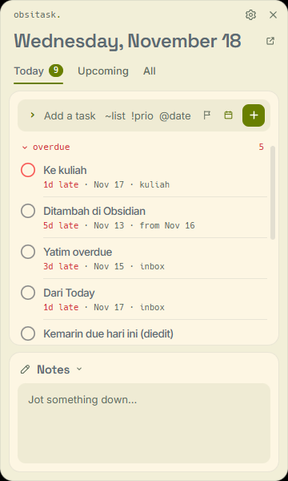

Lapisan: panel `#f2efd8` · kartu `#fdf6e3` · kolom `#efebd4` · popover `#fdf6e3` — urutan benar.

| Pasangan | Depan / latar | Rasio | Batas | Hasil | Penyesuaian |
|---|---|---|---|---|---|
| Teks utama di kartu | `#5c6a72` / `#fdf6e3` | 5.18 | 4.5 | lulus | — |
| Teks utama di kolom | `#5c6a72` / `#efebd4` | 4.66 | 4.5 | lulus | — |
| Teks redup (muted) di kartu | `#5f6d5e` / `#fdf6e3` | 5.08 | 4.5 | lulus | muted: #829181 → #5f6d5e |
| Teks redup di kolom | `#5f6d5e` / `#efebd4` | 4.56 | 4.5 | lulus | muted: #829181 → #5f6d5e |
| Teks samar di kartu (Completed, tanggal, No tasks.) | `#626d5e` / `#fdf6e3` | 5.03 | 4.5 | lulus | faint: #94a090 → #626d5e |
| Teks samar di kolom | `#626d5e` / `#efebd4` | 4.52 | 4.5 | lulus | faint: #94a090 → #626d5e |
| Placeholder di kartu | `#626d5e` / `#fdf6e3` | 5.03 | 4.5 | lulus | placeholder: #94a090 → #626d5e |
| Placeholder di kolom (bar tambah, Notes) | `#626d5e` / `#efebd4` | 4.52 | 4.5 | lulus | placeholder: #94a090 → #626d5e |
| Judul di panel (teks besar) | `#5c6a72` / `#f2efd8` | 4.82 | 3 | lulus | — |
| Tab tidak aktif di panel | `#5f6d5e` / `#f2efd8` | 4.72 | 4.5 | lulus | muted: #829181 → #5f6d5e |
| Teks aksen di kartu (~list, ›) | `#5b7200` / `#fdf6e3` | 5.05 | 4.5 | lulus | primaryText: #8da101 → #5b7200 |
| Teks aksen di kolom | `#5b7200` / `#efebd4` | 4.54 | 4.5 | lulus | primaryText: #8da101 → #5b7200 |
| Teks/ikon di atas aksen (badge Today, tombol +) | `#ffffff` / `#697f00` | 4.53 | 4.5 | lulus | onPrimary: #fdf6e3 → #ffffff |
| Aksen di panel (garis tab aktif) | `#697f00` / `#f2efd8` | 3.91 | 3 | lulus | primary: #8da101 → #7d9200; primary: #7d9200 → #697f00 |
| Aksen di kartu (+ di All, checkbox selesai) | `#697f00` / `#fdf6e3` | 4.20 | 3 | lulus | primary: #8da101 → #7d9200; primary: #7d9200 → #697f00 |
| Overdue / "2d late" di kartu | `#d33237` / `#fdf6e3` | 4.55 | 4.5 | lulus | danger: #f85552 → #d33237 |
| Lingkaran high di kartu | `#f85552` / `#fdf6e3` | 3.04 | 3 | lulus | — |
| Lingkaran medium di kartu | `#9f6a00` / `#fdf6e3` | 4.29 | 3 | lulus | medium: #dfa000 → #bd8300; medium: #bd8300 → #9f6a00 |
| Lingkaran low di kartu | `#3a94c5` / `#fdf6e3` | 3.13 | 3 | lulus | — |
| Lingkaran tanpa prioritas di kartu | `#8a8a8a` / `#fdf6e3` | 3.20 | 3 | lulus | — |

Prioritas (ΔE2000 normal / deuteranopia / protanopia; batas 20 / 12 / 12):

| Pasangan | Normal | Deutan | Protan | Hasil |
|---|---|---|---|---|
| high–medium | 32.4 | 12.3 | 12.6 | lulus |
| high–low | 51.8 | 52.5 | 39.8 | lulus |
| medium–low | 50.2 | 55.6 | 52.4 | lulus |

Semua penyesuaian:

| Token | Sumber → dipakai | Alasan |
|---|---|---|
| background/card | #fdf6e3 / #f4f0d9 → #f4f0d9 / #fdf6e3 | Terax card is darker than background: swapped so the card is the lightest layer |
| background | #f4f0d9 → #f2efd8 | card not visibly lighter than panel (needs 1.07:1): panel darkened |
| muted | #829181 → #5f6d5e | dim text: 2.77 → 4.56 on panel/card/well/pop (needs 4.5) |
| faint | #94a090 → #626d5e | faint text: 2.28 → 4.52 on card/well (needs 4.5) |
| placeholder | #94a090 → #626d5e | placeholder: 2.28 → 4.52 on card/well (needs 4.5) |
| primaryText | #8da101 → #5b7200 | accent text: 2.42 → 4.54 on card/well (needs 4.5) |
| danger | #f85552 → #d33237 | overdue text: 3.04 → 4.55 on card/pop (needs 4.5) |
| tag | #35a77c → #008159 | tag text: 2.79 → 4.54 on card (needs 4.5) |
| medium | #dfa000 → #bd8300 | medium circle: 2.12 → 3.04 on card (needs 3) |
| primary | #8da101 → #7d9200 | accent (tab line, + icon, done fill): 2.51 → 3.03 on panel/card (needs 3) |
| onPrimary | #fdf6e3 → #ffffff | text on accent: 3.25 → 4.53 (needs 4.5) |
| primary | #7d9200 → #697f00 | text on accent still below 4.5 with black/white text: accent shifted |
| medium | #bd8300 → #9f6a00 | priority colors too similar (normal or red-green colour blindness): lightness shifted |

## Nord — gelap

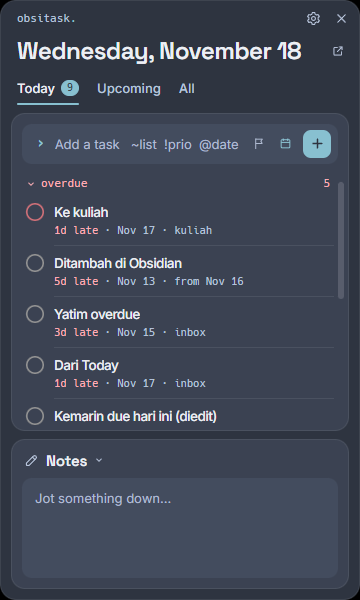

Lapisan: panel `#2e3440` · kartu `#3b4252` · kolom `#434c5e` · popover `#495263` — urutan benar.

| Pasangan | Depan / latar | Rasio | Batas | Hasil | Penyesuaian |
|---|---|---|---|---|---|
| Teks utama di kartu | `#eceff4` / `#3b4252` | 8.73 | 4.5 | lulus | — |
| Teks utama di kolom | `#eceff4` / `#434c5e` | 7.49 | 4.5 | lulus | — |
| Teks redup (muted) di kartu | `#b8c5dc` / `#3b4252` | 5.78 | 4.5 | lulus | muted: #9aa6bd → #b8c5dc |
| Teks redup di kolom | `#b8c5dc` / `#434c5e` | 4.95 | 4.5 | lulus | muted: #9aa6bd → #b8c5dc |
| Teks samar di kartu (Completed, tanggal, No tasks.) | `#b1bcd3` / `#3b4252` | 5.27 | 4.5 | lulus | faint: #8c97ad → #b1bcd3 |
| Teks samar di kolom | `#b1bcd3` / `#434c5e` | 4.52 | 4.5 | lulus | faint: #8c97ad → #b1bcd3 |
| Placeholder di kartu | `#b1bcd3` / `#3b4252` | 5.27 | 4.5 | lulus | placeholder: #8c97ad → #b1bcd3 |
| Placeholder di kolom (bar tambah, Notes) | `#b1bcd3` / `#434c5e` | 4.52 | 4.5 | lulus | placeholder: #8c97ad → #b1bcd3 |
| Judul di panel (teks besar) | `#eceff4` / `#2e3440` | 10.84 | 3 | lulus | — |
| Tab tidak aktif di panel | `#b8c5dc` / `#2e3440` | 7.17 | 4.5 | lulus | muted: #9aa6bd → #b8c5dc |
| Teks aksen di kartu (~list, ›) | `#8cc4d4` / `#3b4252` | 5.25 | 4.5 | lulus | primaryText: #88c0d0 → #8cc4d4 |
| Teks aksen di kolom | `#8cc4d4` / `#434c5e` | 4.50 | 4.5 | lulus | primaryText: #88c0d0 → #8cc4d4 |
| Teks/ikon di atas aksen (badge Today, tombol +) | `#2e3440` / `#88c0d0` | 6.24 | 4.5 | lulus | — |
| Aksen di panel (garis tab aktif) | `#88c0d0` / `#2e3440` | 6.24 | 3 | lulus | — |
| Aksen di kartu (+ di All, checkbox selesai) | `#88c0d0` / `#3b4252` | 5.03 | 3 | lulus | — |
| Overdue / "2d late" di kartu | `#ffafb6` / `#3b4252` | 5.78 | 4.5 | lulus | danger: #bf616a → #ffafb6 |
| Lingkaran high di kartu | `#d07078` / `#3b4252` | 3.00 | 3 | lulus | high: #bf616a → #d07078 |
| Lingkaran medium di kartu | `#ebcb8b` / `#3b4252` | 6.44 | 3 | lulus | — |
| Lingkaran low di kartu | `#81a1c1` / `#3b4252` | 3.74 | 3 | lulus | — |
| Lingkaran tanpa prioritas di kartu | `#929292` / `#3b4252` | 3.23 | 3 | lulus | — |

Prioritas (ΔE2000 normal / deuteranopia / protanopia; batas 20 / 12 / 12):

| Pasangan | Normal | Deutan | Protan | Hasil |
|---|---|---|---|---|
| high–medium | 36.6 | 19.7 | 28.2 | lulus |
| high–low | 35.7 | 32.9 | 22.7 | lulus |
| medium–low | 40.2 | 44.4 | 40.5 | lulus |

Semua penyesuaian:

| Token | Sumber → dipakai | Alasan |
|---|---|---|
| muted | #9aa6bd → #b8c5dc | dim text: 3.21 → 4.52 on panel/card/well/pop (needs 4.5) |
| faint | #8c97ad → #b1bcd3 | faint text: 2.94 → 4.52 on card/well (needs 4.5) |
| placeholder | #8c97ad → #b1bcd3 | placeholder: 2.94 → 4.52 on card/well (needs 4.5) |
| primaryText | #88c0d0 → #8cc4d4 | accent text: 4.31 → 4.50 on card/well (needs 4.5) |
| danger | #bf616a → #ffafb6 | overdue text: 1.92 → 4.52 on card/pop (needs 4.5) |
| high | #bf616a → #d07078 | high circle: 2.46 → 3.00 on card (needs 3) |

## Nord — terang

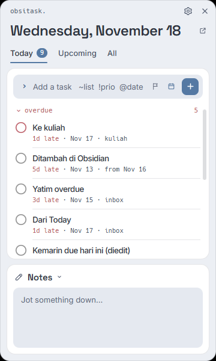

Lapisan: panel `#eceff4` · kartu `#ffffff` · kolom `#e5e9f0` · popover `#ffffff` — urutan benar.

| Pasangan | Depan / latar | Rasio | Batas | Hasil | Penyesuaian |
|---|---|---|---|---|---|
| Teks utama di kartu | `#2e3440` / `#ffffff` | 12.49 | 4.5 | lulus | — |
| Teks utama di kolom | `#2e3440` / `#e5e9f0` | 10.26 | 4.5 | lulus | — |
| Teks redup (muted) di kartu | `#4c566a` / `#ffffff` | 7.38 | 4.5 | lulus | — |
| Teks redup di kolom | `#4c566a` / `#e5e9f0` | 6.06 | 4.5 | lulus | — |
| Teks samar di kartu (Completed, tanggal, No tasks.) | `#61697a` / `#ffffff` | 5.51 | 4.5 | lulus | faint: #676f80 → #61697a |
| Teks samar di kolom | `#61697a` / `#e5e9f0` | 4.53 | 4.5 | lulus | faint: #676f80 → #61697a |
| Placeholder di kartu | `#61697a` / `#ffffff` | 5.51 | 4.5 | lulus | placeholder: #676f80 → #61697a |
| Placeholder di kolom (bar tambah, Notes) | `#61697a` / `#e5e9f0` | 4.53 | 4.5 | lulus | placeholder: #676f80 → #61697a |
| Judul di panel (teks besar) | `#2e3440` / `#eceff4` | 10.84 | 3 | lulus | — |
| Tab tidak aktif di panel | `#4c566a` / `#eceff4` | 6.40 | 4.5 | lulus | — |
| Teks aksen di kartu (~list, ›) | `#476b95` / `#ffffff` | 5.52 | 4.5 | lulus | primaryText: #5e81ac → #476b95 |
| Teks aksen di kolom | `#476b95` / `#e5e9f0` | 4.53 | 4.5 | lulus | primaryText: #5e81ac → #476b95 |
| Teks/ikon di atas aksen (badge Today, tombol +) | `#ffffff` / `#5579a3` | 4.52 | 4.5 | lulus | onPrimary: #eceff4 → #ffffff |
| Aksen di panel (garis tab aktif) | `#5579a3` / `#eceff4` | 3.92 | 3 | lulus | primary: #5e81ac → #5579a3 |
| Aksen di kartu (+ di All, checkbox selesai) | `#5579a3` / `#ffffff` | 4.52 | 3 | lulus | primary: #5e81ac → #5579a3 |
| Overdue / "2d late" di kartu | `#b75a63` / `#ffffff` | 4.51 | 4.5 | lulus | danger: #bf616a → #b75a63 |
| Lingkaran high di kartu | `#bc5e68` / `#ffffff` | 4.25 | 3 | lulus | high: #bf616a → #bc5e68 |
| Lingkaran medium di kartu | `#ad9154` / `#ffffff` | 3.02 | 3 | lulus | medium: #ebcb8b → #ad9154 |
| Lingkaran low di kartu | `#7898b8` / `#ffffff` | 3.01 | 3 | lulus | low: #81a1c1 → #7898b8 |
| Lingkaran tanpa prioritas di kartu | `#8f8f8f` / `#ffffff` | 3.23 | 3 | lulus | — |

Prioritas (ΔE2000 normal / deuteranopia / protanopia; batas 20 / 12 / 12):

| Pasangan | Normal | Deutan | Protan | Hasil |
|---|---|---|---|---|
| high–medium | 33 | 12.2 | 22 | lulus |
| high–low | 36.5 | 33.1 | 24.4 | lulus |
| medium–low | 38.1 | 42 | 38.9 | lulus |

Semua penyesuaian:

| Token | Sumber → dipakai | Alasan |
|---|---|---|
| faint | #676f80 → #61697a | faint text: 4.14 → 4.53 on card/well (needs 4.5) |
| placeholder | #676f80 → #61697a | placeholder: 4.14 → 4.53 on card/well (needs 4.5) |
| primaryText | #5e81ac → #476b95 | accent text: 3.31 → 4.53 on card/well (needs 4.5) |
| danger | #bf616a → #b75a63 | overdue text: 4.09 → 4.51 on card/pop (needs 4.5) |
| tag | #88c0d0 → #467e8d | tag text: 2.00 → 4.54 on card (needs 4.5) |
| medium | #ebcb8b → #ad9154 | medium circle: 1.56 → 3.02 on card (needs 3) |
| low | #81a1c1 → #7898b8 | low circle: 2.69 → 3.01 on card (needs 3) |
| onPrimary | #eceff4 → #ffffff | text on accent: 3.50 → 4.52 (needs 4.5) |
| primary | #5e81ac → #5579a3 | text on accent still below 4.5 with black/white text: accent shifted |
| high | #bf616a → #bc5e68 | priority colors too similar (normal or red-green colour blindness): lightness shifted |

## Gruvbox — gelap

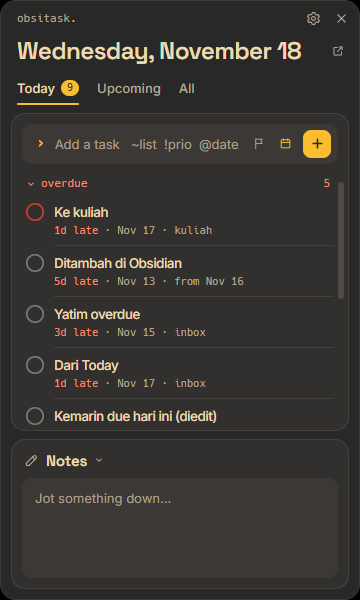

Lapisan: panel `#282828` · kartu `#32302f` · kolom `#3c3836` · popover `#423e3a` — urutan benar.

| Pasangan | Depan / latar | Rasio | Batas | Hasil | Penyesuaian |
|---|---|---|---|---|---|
| Teks utama di kartu | `#ebdbb2` / `#32302f` | 9.57 | 4.5 | lulus | — |
| Teks utama di kolom | `#ebdbb2` / `#3c3836` | 8.45 | 4.5 | lulus | — |
| Teks redup (muted) di kartu | `#b6a792` / `#32302f` | 5.58 | 4.5 | lulus | muted: #a89984 → #b6a792 |
| Teks redup di kolom | `#b6a792` / `#3c3836` | 4.93 | 4.5 | lulus | muted: #a89984 → #b6a792 |
| Teks samar di kartu (Completed, tanggal, No tasks.) | `#ada08d` / `#32302f` | 5.12 | 4.5 | lulus | faint: #968977 → #ada08d |
| Teks samar di kolom | `#ada08d` / `#3c3836` | 4.52 | 4.5 | lulus | faint: #968977 → #ada08d |
| Placeholder di kartu | `#ada08d` / `#32302f` | 5.12 | 4.5 | lulus | placeholder: #968977 → #ada08d |
| Placeholder di kolom (bar tambah, Notes) | `#ada08d` / `#3c3836` | 4.52 | 4.5 | lulus | placeholder: #968977 → #ada08d |
| Judul di panel (teks besar) | `#ebdbb2` / `#282828` | 10.75 | 3 | lulus | — |
| Tab tidak aktif di panel | `#b6a792` / `#282828` | 6.27 | 4.5 | lulus | muted: #a89984 → #b6a792 |
| Teks aksen di kartu (~list, ›) | `#fabd2f` / `#32302f` | 7.74 | 4.5 | lulus | — |
| Teks aksen di kolom | `#fabd2f` / `#3c3836` | 6.84 | 4.5 | lulus | — |
| Teks/ikon di atas aksen (badge Today, tombol +) | `#282828` / `#fabd2f` | 8.69 | 4.5 | lulus | — |
| Aksen di panel (garis tab aktif) | `#fabd2f` / `#282828` | 8.69 | 3 | lulus | — |
| Aksen di kartu (+ di All, checkbox selesai) | `#fabd2f` / `#32302f` | 7.74 | 3 | lulus | — |
| Overdue / "2d late" di kartu | `#ff8868` / `#32302f` | 5.61 | 4.5 | lulus | danger: #fb4934 → #ff8868 |
| Lingkaran high di kartu | `#e03a2b` / `#32302f` | 3.01 | 3 | lulus | high: #cc241d → #e03a2b |
| Lingkaran medium di kartu | `#d79921` / `#32302f` | 5.29 | 3 | lulus | — |
| Lingkaran low di kartu | `#458588` / `#32302f` | 3.10 | 3 | lulus | — |
| Lingkaran tanpa prioritas di kartu | `#7e7e7e` / `#32302f` | 3.23 | 3 | lulus | — |

Prioritas (ΔE2000 normal / deuteranopia / protanopia; batas 20 / 12 / 12):

| Pasangan | Normal | Deutan | Protan | Hasil |
|---|---|---|---|---|
| high–medium | 34 | 12.5 | 25.9 | lulus |
| high–low | 48.1 | 37.6 | 27.9 | lulus |
| medium–low | 40.6 | 43.2 | 33.7 | lulus |

Semua penyesuaian:

| Token | Sumber → dipakai | Alasan |
|---|---|---|
| muted | #a89984 → #b6a792 | dim text: 3.81 → 4.51 on panel/card/well/pop (needs 4.5) |
| faint | #968977 → #ada08d | faint text: 3.39 → 4.52 on card/well (needs 4.5) |
| placeholder | #968977 → #ada08d | placeholder: 3.39 → 4.52 on card/well (needs 4.5) |
| danger | #fb4934 → #ff8868 | overdue text: 3.08 → 4.53 on card/pop (needs 4.5) |
| tag | #689d6a → #6ea470 | tag text: 4.14 → 4.51 on card (needs 4.5) |
| high | #cc241d → #e03a2b | high circle: 2.40 → 3.01 on card (needs 3) |

## Gruvbox — terang

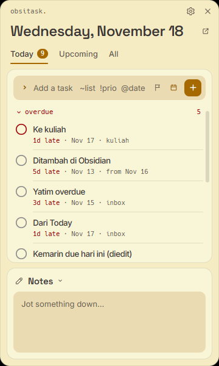

Lapisan: panel `#f6ecc3` · kartu `#f9f5d7` · kolom `#ebdbb2` · popover `#f9f5d7` — urutan benar.

| Pasangan | Depan / latar | Rasio | Batas | Hasil | Penyesuaian |
|---|---|---|---|---|---|
| Teks utama di kartu | `#3c3836` / `#f9f5d7` | 10.53 | 4.5 | lulus | — |
| Teks utama di kolom | `#3c3836` / `#ebdbb2` | 8.45 | 4.5 | lulus | — |
| Teks redup (muted) di kartu | `#6b5e54` / `#f9f5d7` | 5.69 | 4.5 | lulus | muted: #7c6f64 → #6b5e54 |
| Teks redup di kolom | `#6b5e54` / `#ebdbb2` | 4.56 | 4.5 | lulus | muted: #7c6f64 → #6b5e54 |
| Teks samar di kartu (Completed, tanggal, No tasks.) | `#6b5f52` / `#f9f5d7` | 5.64 | 4.5 | lulus | faint: #8f8375 → #6b5f52 |
| Teks samar di kolom | `#6b5f52` / `#ebdbb2` | 4.52 | 4.5 | lulus | faint: #8f8375 → #6b5f52 |
| Placeholder di kartu | `#6b5f52` / `#f9f5d7` | 5.64 | 4.5 | lulus | placeholder: #8f8375 → #6b5f52 |
| Placeholder di kolom (bar tambah, Notes) | `#6b5f52` / `#ebdbb2` | 4.52 | 4.5 | lulus | placeholder: #8f8375 → #6b5f52 |
| Judul di panel (teks besar) | `#3c3836` / `#f6ecc3` | 9.78 | 3 | lulus | — |
| Tab tidak aktif di panel | `#6b5e54` / `#f6ecc3` | 5.28 | 4.5 | lulus | muted: #7c6f64 → #6b5e54 |
| Teks aksen di kartu (~list, ›) | `#8c5400` / `#f9f5d7` | 5.64 | 4.5 | lulus | primaryText: #b57614 → #8c5400 |
| Teks aksen di kolom | `#8c5400` / `#ebdbb2` | 4.52 | 4.5 | lulus | primaryText: #b57614 → #8c5400 |
| Teks/ikon di atas aksen (badge Today, tombol +) | `#ffffff` / `#a56900` | 4.54 | 4.5 | lulus | onPrimary: #fbf1c7 → #ffffff |
| Aksen di panel (garis tab aktif) | `#a56900` / `#f6ecc3` | 3.83 | 3 | lulus | primary: #b57614 → #a56900 |
| Aksen di kartu (+ di All, checkbox selesai) | `#a56900` / `#f9f5d7` | 4.13 | 3 | lulus | primary: #b57614 → #a56900 |
| Overdue / "2d late" di kartu | `#9d0006` / `#f9f5d7` | 7.83 | 4.5 | lulus | — |
| Lingkaran high di kartu | `#9d0006` / `#f9f5d7` | 7.83 | 3 | lulus | — |
| Lingkaran medium di kartu | `#b57614` / `#f9f5d7` | 3.43 | 3 | lulus | — |
| Lingkaran low di kartu | `#076678` / `#f9f5d7` | 6.00 | 3 | lulus | — |
| Lingkaran tanpa prioritas di kartu | `#888888` / `#f9f5d7` | 3.22 | 3 | lulus | — |

Prioritas (ΔE2000 normal / deuteranopia / protanopia; batas 20 / 12 / 12):

| Pasangan | Normal | Deutan | Protan | Hasil |
|---|---|---|---|---|
| high–medium | 32.1 | 20.3 | 26.6 | lulus |
| high–low | 55.4 | 42.3 | 35.4 | lulus |
| medium–low | 44.2 | 50 | 40.9 | lulus |

Semua penyesuaian:

| Token | Sumber → dipakai | Alasan |
|---|---|---|
| background | #fbf1c7 → #f6ecc3 | card not visibly lighter than panel (needs 1.07:1): panel darkened |
| muted | #7c6f64 → #6b5e54 | dim text: 3.55 → 4.56 on panel/card/well/pop (needs 4.5) |
| faint | #8f8375 → #6b5f52 | faint text: 2.70 → 4.52 on card/well (needs 4.5) |
| placeholder | #8f8375 → #6b5f52 | placeholder: 2.70 → 4.52 on card/well (needs 4.5) |
| primaryText | #b57614 → #8c5400 | accent text: 2.75 → 4.52 on card/well (needs 4.5) |
| onPrimary | #fbf1c7 → #ffffff | text on accent: 3.33 → 4.54 (needs 4.5) |
| primary | #b57614 → #a56900 | text on accent still below 4.5 with black/white text: accent shifted |

## Dracula — gelap

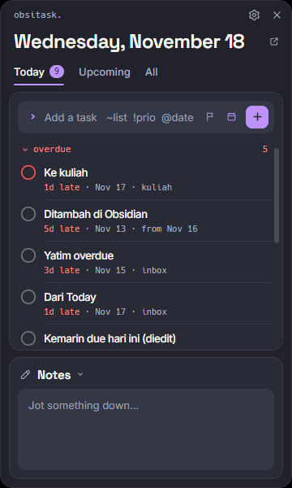

Lapisan: panel `#21222c` · kartu `#282a36` · kolom `#343746` · popover `#3a3d4b` — urutan benar.

| Pasangan | Depan / latar | Rasio | Batas | Hasil | Penyesuaian |
|---|---|---|---|---|---|
| Teks utama di kartu | `#f8f8f2` / `#282a36` | 13.36 | 4.5 | lulus | — |
| Teks utama di kolom | `#f8f8f2` / `#343746` | 11.06 | 4.5 | lulus | — |
| Teks redup (muted) di kartu | `#a9acc0` / `#282a36` | 6.34 | 4.5 | lulus | — |
| Teks redup di kolom | `#a9acc0` / `#343746` | 5.25 | 4.5 | lulus | — |
| Teks samar di kartu (Completed, tanggal, No tasks.) | `#9da0b2` / `#282a36` | 5.50 | 4.5 | lulus | faint: #9699ab → #9da0b2 |
| Teks samar di kolom | `#9da0b2` / `#343746` | 4.55 | 4.5 | lulus | faint: #9699ab → #9da0b2 |
| Placeholder di kartu | `#9da0b2` / `#282a36` | 5.50 | 4.5 | lulus | placeholder: #9699ab → #9da0b2 |
| Placeholder di kolom (bar tambah, Notes) | `#9da0b2` / `#343746` | 4.55 | 4.5 | lulus | placeholder: #9699ab → #9da0b2 |
| Judul di panel (teks besar) | `#f8f8f2` / `#21222c` | 14.81 | 3 | lulus | — |
| Tab tidak aktif di panel | `#a9acc0` / `#21222c` | 7.03 | 4.5 | lulus | — |
| Teks aksen di kartu (~list, ›) | `#bd93f9` / `#282a36` | 5.90 | 4.5 | lulus | — |
| Teks aksen di kolom | `#bd93f9` / `#343746` | 4.89 | 4.5 | lulus | — |
| Teks/ikon di atas aksen (badge Today, tombol +) | `#282a36` / `#bd93f9` | 5.90 | 4.5 | lulus | — |
| Aksen di panel (garis tab aktif) | `#bd93f9` / `#21222c` | 6.55 | 3 | lulus | — |
| Aksen di kartu (+ di All, checkbox selesai) | `#bd93f9` / `#282a36` | 5.90 | 3 | lulus | — |
| Overdue / "2d late" di kartu | `#ff837c` / `#282a36` | 5.96 | 4.5 | lulus | danger: #ff5555 → #ff837c |
| Lingkaran high di kartu | `#ff5555` / `#282a36` | 4.53 | 3 | lulus | — |
| Lingkaran medium di kartu | `#f1fa8c` / `#282a36` | 12.74 | 3 | lulus | — |
| Lingkaran low di kartu | `#bd93f9` / `#282a36` | 5.90 | 3 | lulus | — |
| Lingkaran tanpa prioritas di kartu | `#787878` / `#282a36` | 3.23 | 3 | lulus | — |

Prioritas (ΔE2000 normal / deuteranopia / protanopia; batas 20 / 12 / 12):

| Pasangan | Normal | Deutan | Protan | Hasil |
|---|---|---|---|---|
| high–medium | 58.1 | 21.5 | 36.4 | lulus |
| high–low | 36 | 56 | 47.5 | lulus |
| medium–low | 68.1 | 61.3 | 64.1 | lulus |

Semua penyesuaian:

| Token | Sumber → dipakai | Alasan |
|---|---|---|
| background/card | #282a36 / #21222c → #21222c / #282a36 | Terax card is darker than background: swapped so the panel is the darkest layer |
| accent (hover) | #44475a → rgba(248, 248, 242, 0.05) | accent too far from card for a hover |
| faint | #9699ab → #9da0b2 | faint text: 4.18 → 4.55 on card/well (needs 4.5) |
| placeholder | #9699ab → #9da0b2 | placeholder: 4.18 → 4.55 on card/well (needs 4.5) |
| danger | #ff5555 → #ff837c | overdue text: 3.43 → 4.51 on card/pop (needs 4.5) |

## Solarized — gelap

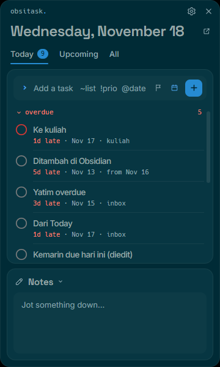

Lapisan: panel `#002b36` · kartu `#073642` · kolom `#0d3b46` · popover `#14414b` — urutan benar.

| Pasangan | Depan / latar | Rasio | Batas | Hasil | Penyesuaian |
|---|---|---|---|---|---|
| Teks utama di kartu | `#9aa8a8` / `#073642` | 5.29 | 4.5 | lulus | text: #93a1a1 → #9aa8a8 |
| Teks utama di kolom | `#9aa8a8` / `#0d3b46` | 4.93 | 4.5 | lulus | text: #93a1a1 → #9aa8a8 |
| Teks redup (muted) di kartu | `#92a9b1` / `#073642` | 5.28 | 4.5 | lulus | muted: #657b83 → #92a9b1 |
| Teks redup di kolom | `#92a9b1` / `#0d3b46` | 4.93 | 4.5 | lulus | muted: #657b83 → #92a9b1 |
| Teks samar di kartu (Completed, tanggal, No tasks.) | `#88a3ab` / `#073642` | 4.87 | 4.5 | lulus | faint: #577179 → #88a3ab |
| Teks samar di kolom | `#88a3ab` / `#0d3b46` | 4.55 | 4.5 | lulus | faint: #577179 → #88a3ab |
| Placeholder di kartu | `#88a3ab` / `#073642` | 4.87 | 4.5 | lulus | placeholder: #577179 → #88a3ab |
| Placeholder di kolom (bar tambah, Notes) | `#88a3ab` / `#0d3b46` | 4.55 | 4.5 | lulus | placeholder: #577179 → #88a3ab |
| Judul di panel (teks besar) | `#9aa8a8` / `#002b36` | 6.11 | 3 | lulus | text: #93a1a1 → #9aa8a8 |
| Tab tidak aktif di panel | `#92a9b1` / `#002b36` | 6.10 | 4.5 | lulus | muted: #657b83 → #92a9b1 |
| Teks aksen di kartu (~list, ›) | `#4da4ed` / `#073642` | 4.86 | 4.5 | lulus | primaryText: #268bd2 → #4da4ed |
| Teks aksen di kolom | `#4da4ed` / `#0d3b46` | 4.53 | 4.5 | lulus | primaryText: #268bd2 → #4da4ed |
| Teks/ikon di atas aksen (badge Today, tombol +) | `#00222d` / `#268bd2` | 4.50 | 4.5 | lulus | onPrimary: #002b36 → #00222d |
| Aksen di panel (garis tab aktif) | `#268bd2` / `#002b36` | 4.08 | 3 | lulus | — |
| Aksen di kartu (+ di All, checkbox selesai) | `#268bd2` / `#073642` | 3.53 | 3 | lulus | — |
| Overdue / "2d late" di kartu | `#ff7f6d` / `#073642` | 5.27 | 4.5 | lulus | danger: #dc322f → #ff7f6d |
| Lingkaran high di kartu | `#e23833` / `#073642` | 3.00 | 3 | lulus | high: #dc322f → #e23833 |
| Lingkaran medium di kartu | `#cd9e23` / `#073642` | 5.27 | 3 | lulus | medium: #b58900 → #cd9e23 |
| Lingkaran low di kartu | `#268bd2` / `#073642` | 3.53 | 3 | lulus | — |
| Lingkaran tanpa prioritas di kartu | `#7e7e7e` / `#073642` | 3.20 | 3 | lulus | — |

Prioritas (ΔE2000 normal / deuteranopia / protanopia; batas 20 / 12 / 12):

| Pasangan | Normal | Deutan | Protan | Hasil |
|---|---|---|---|---|
| high–medium | 39.2 | 12.3 | 27.5 | lulus |
| high–low | 49.9 | 59.4 | 49.2 | lulus |
| medium–low | 51.7 | 64.9 | 59.6 | lulus |

Semua penyesuaian:

| Token | Sumber → dipakai | Alasan |
|---|---|---|
| secondary | #073642 → #0d3b46 | inner field not visibly lighter than card (needs 1.07:1) |
| text | #93a1a1 → #9aa8a8 | main text: 4.16 → 4.52 on panel/card/well/pop (needs 4.5) |
| muted | #657b83 → #92a9b1 | dim text: 2.50 → 4.52 on panel/card/well/pop (needs 4.5) |
| faint | #577179 → #88a3ab | faint text: 2.34 → 4.55 on card/well (needs 4.5) |
| placeholder | #577179 → #88a3ab | placeholder: 2.34 → 4.55 on card/well (needs 4.5) |
| primaryText | #268bd2 → #4da4ed | accent text: 3.30 → 4.53 on card/well (needs 4.5) |
| danger | #dc322f → #ff7f6d | overdue text: 2.41 → 4.51 on card/pop (needs 4.5) |
| tag | #2aa198 → #35a9a0 | tag text: 4.12 → 4.54 on card (needs 4.5) |
| high | #dc322f → #e23833 | high circle: 2.81 → 3.00 on card (needs 3) |
| onPrimary | #002b36 → #00222d | text on accent: 4.08 → 4.50 (needs 4.5) |
| medium | #b58900 → #cd9e23 | priority colors too similar (normal or red-green colour blindness): lightness shifted |

## Solarized — terang

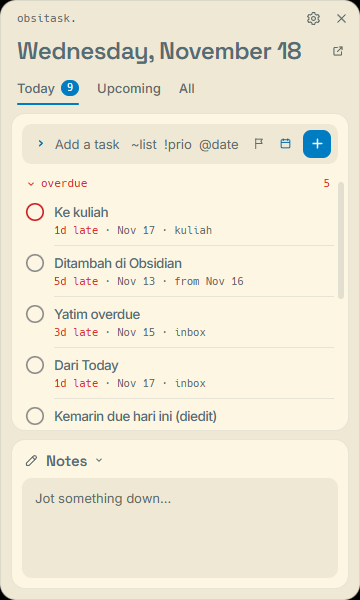

Lapisan: panel `#eee8d5` · kartu `#fdf6e3` · kolom `#eee8d5` · popover `#fdf6e3` — urutan benar.

| Pasangan | Depan / latar | Rasio | Batas | Hasil | Penyesuaian |
|---|---|---|---|---|---|
| Teks utama di kartu | `#566c73` / `#fdf6e3` | 5.14 | 4.5 | lulus | text: #586e75 → #566c73 |
| Teks utama di kolom | `#566c73` / `#eee8d5` | 4.52 | 4.5 | lulus | text: #586e75 → #566c73 |
| Teks redup (muted) di kartu | `#5e6b6b` / `#fdf6e3` | 5.13 | 4.5 | lulus | muted: #93a1a1 → #5e6b6b |
| Teks redup di kolom | `#5e6b6b` / `#eee8d5` | 4.52 | 4.5 | lulus | muted: #93a1a1 → #5e6b6b |
| Teks samar di kartu (Completed, tanggal, No tasks.) | `#606a67` / `#fdf6e3` | 5.18 | 4.5 | lulus | faint: #a3aeab → #606a67 |
| Teks samar di kolom | `#606a67` / `#eee8d5` | 4.56 | 4.5 | lulus | faint: #a3aeab → #606a67 |
| Placeholder di kartu | `#606a67` / `#fdf6e3` | 5.18 | 4.5 | lulus | placeholder: #a3aeab → #606a67 |
| Placeholder di kolom (bar tambah, Notes) | `#606a67` / `#eee8d5` | 4.56 | 4.5 | lulus | placeholder: #a3aeab → #606a67 |
| Judul di panel (teks besar) | `#566c73` / `#eee8d5` | 4.52 | 3 | lulus | text: #586e75 → #566c73 |
| Tab tidak aktif di panel | `#5e6b6b` / `#eee8d5` | 4.52 | 4.5 | lulus | muted: #93a1a1 → #5e6b6b |
| Teks aksen di kartu (~list, ›) | `#006cb0` / `#fdf6e3` | 5.16 | 4.5 | lulus | primaryText: #268bd2 → #006cb0 |
| Teks aksen di kolom | `#006cb0` / `#eee8d5` | 4.54 | 4.5 | lulus | primaryText: #268bd2 → #006cb0 |
| Teks/ikon di atas aksen (badge Today, tombol +) | `#ffffff` / `#007cc2` | 4.50 | 4.5 | lulus | onPrimary: #fdf6e3 → #ffffff |
| Aksen di panel (garis tab aktif) | `#007cc2` / `#eee8d5` | 3.68 | 3 | lulus | primary: #268bd2 → #007cc2 |
| Aksen di kartu (+ di All, checkbox selesai) | `#007cc2` / `#fdf6e3` | 4.18 | 3 | lulus | primary: #268bd2 → #007cc2 |
| Overdue / "2d late" di kartu | `#d72d2c` / `#fdf6e3` | 4.53 | 4.5 | lulus | danger: #dc322f → #d72d2c |
| Lingkaran high di kartu | `#ca1d23` / `#fdf6e3` | 5.25 | 3 | lulus | high: #dc322f → #ca1d23 |
| Lingkaran medium di kartu | `#b48800` / `#fdf6e3` | 3.01 | 3 | lulus | medium: #b58900 → #b48800 |
| Lingkaran low di kartu | `#268bd2` / `#fdf6e3` | 3.41 | 3 | lulus | — |
| Lingkaran tanpa prioritas di kartu | `#8a8a8a` / `#fdf6e3` | 3.20 | 3 | lulus | — |

Prioritas (ΔE2000 normal / deuteranopia / protanopia; batas 20 / 12 / 12):

| Pasangan | Normal | Deutan | Protan | Hasil |
|---|---|---|---|---|
| high–medium | 39.3 | 12.5 | 26.5 | lulus |
| high–low | 51.1 | 59.4 | 51.3 | lulus |
| medium–low | 50.6 | 63 | 58.9 | lulus |

Semua penyesuaian:

| Token | Sumber → dipakai | Alasan |
|---|---|---|
| background/card | #fdf6e3 / #eee8d5 → #eee8d5 / #fdf6e3 | Terax card is darker than background: swapped so the card is the lightest layer |
| text | #586e75 → #566c73 | main text: 4.39 → 4.52 on panel/card/well/pop (needs 4.5) |
| muted | #93a1a1 → #5e6b6b | dim text: 2.18 → 4.52 on panel/card/well/pop (needs 4.5) |
| faint | #a3aeab → #606a67 | faint text: 1.86 → 4.56 on card/well (needs 4.5) |
| placeholder | #a3aeab → #606a67 | placeholder: 1.86 → 4.56 on card/well (needs 4.5) |
| primaryText | #268bd2 → #006cb0 | accent text: 3.00 → 4.54 on card/well (needs 4.5) |
| danger | #dc322f → #d72d2c | overdue text: 4.29 → 4.53 on card/pop (needs 4.5) |
| tag | #2aa198 → #007f77 | tag text: 2.93 → 4.53 on card (needs 4.5) |
| medium | #b58900 → #b48800 | medium circle: 2.98 → 3.01 on card (needs 3) |
| onPrimary | #fdf6e3 → #ffffff | text on accent: 3.41 → 4.50 (needs 4.5) |
| primary | #268bd2 → #007cc2 | text on accent still below 4.5 with black/white text: accent shifted |
| high | #dc322f → #ca1d23 | priority colors too similar (normal or red-green colour blindness): lightness shifted |

## Tide — gelap

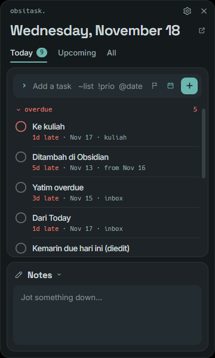

Lapisan: panel `#14191c` · kartu `#1d2327` · kolom `#232c30` · popover `#293236` — urutan benar.

| Pasangan | Depan / latar | Rasio | Batas | Hasil | Penyesuaian |
|---|---|---|---|---|---|
| Teks utama di kartu | `#cdd9da` / `#1d2327` | 10.99 | 4.5 | lulus | — |
| Teks utama di kolom | `#cdd9da` / `#232c30` | 9.86 | 4.5 | lulus | — |
| Teks redup (muted) di kartu | `#93a3a4` / `#1d2327` | 6.06 | 4.5 | lulus | — |
| Teks redup di kolom | `#93a3a4` / `#232c30` | 5.44 | 4.5 | lulus | — |
| Teks samar di kartu (Completed, tanggal, No tasks.) | `#859495` / `#1d2327` | 5.04 | 4.5 | lulus | faint: #819091 → #859495 |
| Teks samar di kolom | `#859495` / `#232c30` | 4.52 | 4.5 | lulus | faint: #819091 → #859495 |
| Placeholder di kartu | `#859495` / `#1d2327` | 5.04 | 4.5 | lulus | placeholder: #819091 → #859495 |
| Placeholder di kolom (bar tambah, Notes) | `#859495` / `#232c30` | 4.52 | 4.5 | lulus | placeholder: #819091 → #859495 |
| Judul di panel (teks besar) | `#cdd9da` / `#14191c` | 12.26 | 3 | lulus | — |
| Tab tidak aktif di panel | `#93a3a4` / `#14191c` | 6.76 | 4.5 | lulus | — |
| Teks aksen di kartu (~list, ›) | `#6cb6b0` / `#1d2327` | 6.77 | 4.5 | lulus | — |
| Teks aksen di kolom | `#6cb6b0` / `#232c30` | 6.07 | 4.5 | lulus | — |
| Teks/ikon di atas aksen (badge Today, tombol +) | `#14191c` / `#6cb6b0` | 7.55 | 4.5 | lulus | — |
| Aksen di panel (garis tab aktif) | `#6cb6b0` / `#14191c` | 7.55 | 3 | lulus | — |
| Aksen di kartu (+ di All, checkbox selesai) | `#6cb6b0` / `#1d2327` | 6.77 | 3 | lulus | — |
| Overdue / "2d late" di kartu | `#e17b6b` / `#1d2327` | 5.48 | 4.5 | lulus | danger: #e07a6a → #e17b6b |
| Lingkaran high di kartu | `#da7565` / `#1d2327` | 5.08 | 3 | lulus | high: #e07a6a → #da7565 |
| Lingkaran medium di kartu | `#d9bd80` / `#1d2327` | 8.73 | 3 | lulus | — |
| Lingkaran low di kartu | `#6fa8c9` / `#1d2327` | 6.14 | 3 | lulus | — |
| Lingkaran tanpa prioritas di kartu | `#707070` / `#1d2327` | 3.21 | 3 | lulus | — |

Prioritas (ΔE2000 normal / deuteranopia / protanopia; batas 20 / 12 / 12):

| Pasangan | Normal | Deutan | Protan | Hasil |
|---|---|---|---|---|
| high–medium | 29.4 | 12 | 19 | lulus |
| high–low | 43.3 | 41.6 | 34 | lulus |
| medium–low | 39.1 | 44.6 | 39.7 | lulus |

Semua penyesuaian:

| Token | Sumber → dipakai | Alasan |
|---|---|---|
| card | #1a2024 → #1d2327 | card not visibly lighter than panel (needs 1.1:1) |
| faint | #819091 → #859495 | faint text: 4.29 → 4.52 on card/well (needs 4.5) |
| placeholder | #819091 → #859495 | placeholder: 4.29 → 4.52 on card/well (needs 4.5) |
| danger | #e07a6a → #e17b6b | overdue text: 4.47 → 4.52 on card/pop (needs 4.5) |
| high | #e07a6a → #da7565 | priority colors too similar (normal or red-green colour blindness): lightness shifted |

## Tide — terang

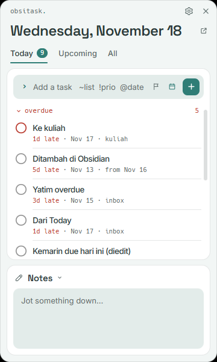

Lapisan: panel `#f2f6f5` · kartu `#ffffff` · kolom `#e3ecea` · popover `#ffffff` — urutan benar.

| Pasangan | Depan / latar | Rasio | Batas | Hasil | Penyesuaian |
|---|---|---|---|---|---|
| Teks utama di kartu | `#2b3a39` / `#ffffff` | 11.88 | 4.5 | lulus | — |
| Teks utama di kolom | `#2b3a39` / `#e3ecea` | 9.88 | 4.5 | lulus | — |
| Teks redup (muted) di kartu | `#5d6c6b` / `#ffffff` | 5.49 | 4.5 | lulus | muted: #5f6e6d → #5d6c6b |
| Teks redup di kolom | `#5d6c6b` / `#e3ecea` | 4.57 | 4.5 | lulus | muted: #5f6e6d → #5d6c6b |
| Teks samar di kartu (Completed, tanggal, No tasks.) | `#5f6c6b` / `#ffffff` | 5.46 | 4.5 | lulus | faint: #778483 → #5f6c6b |
| Teks samar di kolom | `#5f6c6b` / `#e3ecea` | 4.54 | 4.5 | lulus | faint: #778483 → #5f6c6b |
| Placeholder di kartu | `#5f6c6b` / `#ffffff` | 5.46 | 4.5 | lulus | placeholder: #778483 → #5f6c6b |
| Placeholder di kolom (bar tambah, Notes) | `#5f6c6b` / `#e3ecea` | 4.54 | 4.5 | lulus | placeholder: #778483 → #5f6c6b |
| Judul di panel (teks besar) | `#2b3a39` / `#f2f6f5` | 10.91 | 3 | lulus | — |
| Tab tidak aktif di panel | `#5d6c6b` / `#f2f6f5` | 5.04 | 4.5 | lulus | muted: #5f6e6d → #5d6c6b |
| Teks aksen di kartu (~list, ›) | `#26756f` / `#ffffff` | 5.45 | 4.5 | lulus | primaryText: #2f7d76 → #26756f |
| Teks aksen di kolom | `#26756f` / `#e3ecea` | 4.53 | 4.5 | lulus | primaryText: #2f7d76 → #26756f |
| Teks/ikon di atas aksen (badge Today, tombol +) | `#ffffff` / `#2f7d76` | 4.87 | 4.5 | lulus | — |
| Aksen di panel (garis tab aktif) | `#2f7d76` / `#f2f6f5` | 4.47 | 3 | lulus | — |
| Aksen di kartu (+ di All, checkbox selesai) | `#2f7d76` / `#ffffff` | 4.87 | 3 | lulus | — |
| Overdue / "2d late" di kartu | `#c0392b` / `#ffffff` | 5.44 | 4.5 | lulus | — |
| Lingkaran high di kartu | `#b52f23` / `#ffffff` | 6.18 | 3 | lulus | high: #c0392b → #b52f23 |
| Lingkaran medium di kartu | `#a9802a` / `#ffffff` | 3.62 | 3 | lulus | — |
| Lingkaran low di kartu | `#3a6ea5` / `#ffffff` | 5.31 | 3 | lulus | — |
| Lingkaran tanpa prioritas di kartu | `#8f8f8f` / `#ffffff` | 3.23 | 3 | lulus | — |

Prioritas (ΔE2000 normal / deuteranopia / protanopia; batas 20 / 12 / 12):

| Pasangan | Normal | Deutan | Protan | Hasil |
|---|---|---|---|---|
| high–medium | 32.6 | 12.5 | 21.8 | lulus |
| high–low | 43.5 | 53.1 | 44 | lulus |
| medium–low | 46.1 | 56.7 | 51.9 | lulus |

Semua penyesuaian:

| Token | Sumber → dipakai | Alasan |
|---|---|---|
| muted | #5f6e6d → #5d6c6b | dim text: 4.43 → 4.57 on panel/card/well/pop (needs 4.5) |
| faint | #778483 → #5f6c6b | faint text: 3.22 → 4.54 on card/well (needs 4.5) |
| placeholder | #778483 → #5f6c6b | placeholder: 3.22 → 4.54 on card/well (needs 4.5) |
| primaryText | #2f7d76 → #26756f | accent text: 4.04 → 4.53 on card/well (needs 4.5) |
| high | #c0392b → #b52f23 | priority colors too similar (normal or red-green colour blindness): lightness shifted |

## Sage — gelap

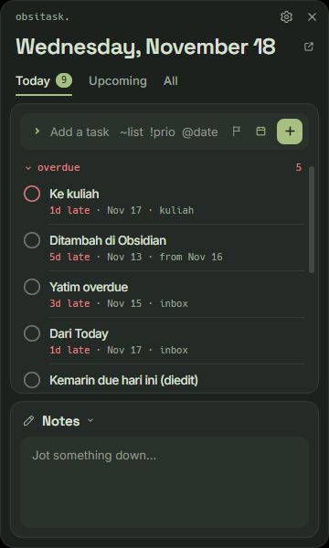

Lapisan: panel `#1c211e` · kartu `#242a26` · kolom `#2a322c` · popover `#303832` — urutan benar.

| Pasangan | Depan / latar | Rasio | Batas | Hasil | Penyesuaian |
|---|---|---|---|---|---|
| Teks utama di kartu | `#d8e0d2` / `#242a26` | 10.82 | 4.5 | lulus | — |
| Teks utama di kolom | `#d8e0d2` / `#2a322c` | 9.75 | 4.5 | lulus | — |
| Teks redup (muted) di kartu | `#9aa597` / `#242a26` | 5.72 | 4.5 | lulus | — |
| Teks redup di kolom | `#9aa597` / `#2a322c` | 5.16 | 4.5 | lulus | — |
| Teks samar di kartu (Completed, tanggal, No tasks.) | `#8f9a8d` / `#242a26` | 5.00 | 4.5 | lulus | faint: #889386 → #8f9a8d |
| Teks samar di kolom | `#8f9a8d` / `#2a322c` | 4.51 | 4.5 | lulus | faint: #889386 → #8f9a8d |
| Placeholder di kartu | `#8f9a8d` / `#242a26` | 5.00 | 4.5 | lulus | placeholder: #889386 → #8f9a8d |
| Placeholder di kolom (bar tambah, Notes) | `#8f9a8d` / `#2a322c` | 4.51 | 4.5 | lulus | placeholder: #889386 → #8f9a8d |
| Judul di panel (teks besar) | `#d8e0d2` / `#1c211e` | 12.07 | 3 | lulus | — |
| Tab tidak aktif di panel | `#9aa597` / `#1c211e` | 6.38 | 4.5 | lulus | — |
| Teks aksen di kartu (~list, ›) | `#a7c080` / `#242a26` | 7.32 | 4.5 | lulus | — |
| Teks aksen di kolom | `#a7c080` / `#2a322c` | 6.60 | 4.5 | lulus | — |
| Teks/ikon di atas aksen (badge Today, tombol +) | `#1c211e` / `#a7c080` | 8.16 | 4.5 | lulus | — |
| Aksen di panel (garis tab aktif) | `#a7c080` / `#1c211e` | 8.16 | 3 | lulus | — |
| Aksen di kartu (+ di All, checkbox selesai) | `#a7c080` / `#242a26` | 7.32 | 3 | lulus | — |
| Overdue / "2d late" di kartu | `#e88082` / `#242a26` | 5.47 | 4.5 | lulus | danger: #e67e80 → #e88082 |
| Lingkaran high di kartu | `#e0797b` / `#242a26` | 5.01 | 3 | lulus | high: #e67e80 → #e0797b |
| Lingkaran medium di kartu | `#dbbc7f` / `#242a26` | 8.03 | 3 | lulus | — |
| Lingkaran low di kartu | `#7fbbb3` / `#242a26` | 6.74 | 3 | lulus | — |
| Lingkaran tanpa prioritas di kartu | `#767676` / `#242a26` | 3.22 | 3 | lulus | — |

Prioritas (ΔE2000 normal / deuteranopia / protanopia; batas 20 / 12 / 12):

| Pasangan | Normal | Deutan | Protan | Hasil |
|---|---|---|---|---|
| high–medium | 32 | 12 | 20.6 | lulus |
| high–low | 46.2 | 21.5 | 14.9 | lulus |
| medium–low | 28.4 | 27.2 | 18.6 | lulus |

Semua penyesuaian:

| Token | Sumber → dipakai | Alasan |
|---|---|---|
| card | #222824 → #242a26 | card not visibly lighter than panel (needs 1.1:1) |
| faint | #889386 → #8f9a8d | faint text: 4.13 → 4.51 on card/well (needs 4.5) |
| placeholder | #889386 → #8f9a8d | placeholder: 4.13 → 4.51 on card/well (needs 4.5) |
| danger | #e67e80 → #e88082 | overdue text: 4.41 → 4.51 on card/pop (needs 4.5) |
| high | #e67e80 → #e0797b | priority colors too similar (normal or red-green colour blindness): lightness shifted |

## Sage — terang

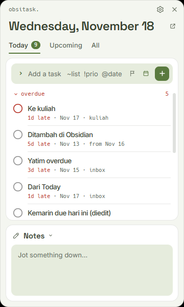

Lapisan: panel `#f4f6f0` · kartu `#ffffff` · kolom `#e6ecdd` · popover `#ffffff` — urutan benar.

| Pasangan | Depan / latar | Rasio | Batas | Hasil | Penyesuaian |
|---|---|---|---|---|---|
| Teks utama di kartu | `#36422f` / `#ffffff` | 10.62 | 4.5 | lulus | — |
| Teks utama di kolom | `#36422f` / `#e6ecdd` | 8.80 | 4.5 | lulus | — |
| Teks redup (muted) di kartu | `#626c5b` / `#ffffff` | 5.50 | 4.5 | lulus | muted: #6b7563 → #626c5b |
| Teks redup di kolom | `#626c5b` / `#e6ecdd` | 4.56 | 4.5 | lulus | muted: #6b7563 → #626c5b |
| Teks samar di kartu (Completed, tanggal, No tasks.) | `#646c5d` / `#ffffff` | 5.46 | 4.5 | lulus | faint: #818a7a → #646c5d |
| Teks samar di kolom | `#646c5d` / `#e6ecdd` | 4.53 | 4.5 | lulus | faint: #818a7a → #646c5d |
| Placeholder di kartu | `#646c5d` / `#ffffff` | 5.46 | 4.5 | lulus | placeholder: #818a7a → #646c5d |
| Placeholder di kolom (bar tambah, Notes) | `#646c5d` / `#e6ecdd` | 4.53 | 4.5 | lulus | placeholder: #818a7a → #646c5d |
| Judul di panel (teks besar) | `#36422f` / `#f4f6f0` | 9.75 | 3 | lulus | — |
| Tab tidak aktif di panel | `#626c5b` / `#f4f6f0` | 5.06 | 4.5 | lulus | muted: #6b7563 → #626c5b |
| Teks aksen di kartu (~list, ›) | `#537238` / `#ffffff` | 5.48 | 4.5 | lulus | primaryText: #5a7a3f → #537238 |
| Teks aksen di kolom | `#537238` / `#e6ecdd` | 4.54 | 4.5 | lulus | primaryText: #5a7a3f → #537238 |
| Teks/ikon di atas aksen (badge Today, tombol +) | `#ffffff` / `#5a7a3f` | 4.89 | 4.5 | lulus | — |
| Aksen di panel (garis tab aktif) | `#5a7a3f` / `#f4f6f0` | 4.50 | 3 | lulus | — |
| Aksen di kartu (+ di All, checkbox selesai) | `#5a7a3f` / `#ffffff` | 4.89 | 3 | lulus | — |
| Overdue / "2d late" di kartu | `#c0392b` / `#ffffff` | 5.44 | 4.5 | lulus | — |
| Lingkaran high di kartu | `#b52f23` / `#ffffff` | 6.18 | 3 | lulus | high: #c0392b → #b52f23 |
| Lingkaran medium di kartu | `#a97f2a` / `#ffffff` | 3.65 | 3 | lulus | — |
| Lingkaran low di kartu | `#3a7a6e` / `#ffffff` | 5.01 | 3 | lulus | — |
| Lingkaran tanpa prioritas di kartu | `#8f8f8f` / `#ffffff` | 3.23 | 3 | lulus | — |

Prioritas (ΔE2000 normal / deuteranopia / protanopia; batas 20 / 12 / 12):

| Pasangan | Normal | Deutan | Protan | Hasil |
|---|---|---|---|---|
| high–medium | 32.1 | 12.3 | 21.4 | lulus |
| high–low | 50.1 | 25.5 | 19.6 | lulus |
| medium–low | 33.6 | 29.1 | 20.8 | lulus |

Semua penyesuaian:

| Token | Sumber → dipakai | Alasan |
|---|---|---|
| muted | #6b7563 → #626c5b | dim text: 4.00 → 4.56 on panel/card/well/pop (needs 4.5) |
| faint | #818a7a → #646c5d | faint text: 2.98 → 4.53 on card/well (needs 4.5) |
| placeholder | #818a7a → #646c5d | placeholder: 2.98 → 4.53 on card/well (needs 4.5) |
| primaryText | #5a7a3f → #537238 | accent text: 4.06 → 4.54 on card/well (needs 4.5) |
| tag | #2a8580 → #27837e | tag text: 4.41 → 4.53 on card (needs 4.5) |
| high | #c0392b → #b52f23 | priority colors too similar (normal or red-green colour blindness): lightness shifted |

## Caffeine — gelap

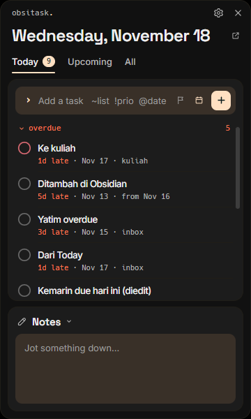

Lapisan: panel `#111111` · kartu `#1c1c1c` · kolom `#393028` · popover `#3e362e` — urutan benar.

| Pasangan | Depan / latar | Rasio | Batas | Hasil | Penyesuaian |
|---|---|---|---|---|---|
| Teks utama di kartu | `#eeeeee` / `#1c1c1c` | 14.69 | 4.5 | lulus | — |
| Teks utama di kolom | `#eeeeee` / `#393028` | 11.12 | 4.5 | lulus | — |
| Teks redup (muted) di kartu | `#b4b4b4` / `#1c1c1c` | 8.22 | 4.5 | lulus | — |
| Teks redup di kolom | `#b4b4b4` / `#393028` | 6.22 | 4.5 | lulus | — |
| Teks samar di kartu (Completed, tanggal, No tasks.) | `#9d9d9d` / `#1c1c1c` | 6.28 | 4.5 | lulus | — |
| Teks samar di kolom | `#9d9d9d` / `#393028` | 4.76 | 4.5 | lulus | — |
| Placeholder di kartu | `#9d9d9d` / `#1c1c1c` | 6.28 | 4.5 | lulus | — |
| Placeholder di kolom (bar tambah, Notes) | `#9d9d9d` / `#393028` | 4.76 | 4.5 | lulus | — |
| Judul di panel (teks besar) | `#eeeeee` / `#111111` | 16.28 | 3 | lulus | — |
| Tab tidak aktif di panel | `#b4b4b4` / `#111111` | 9.11 | 4.5 | lulus | — |
| Teks aksen di kartu (~list, ›) | `#ffe0c2` / `#1c1c1c` | 13.55 | 4.5 | lulus | — |
| Teks aksen di kolom | `#ffe0c2` / `#393028` | 10.26 | 4.5 | lulus | — |
| Teks/ikon di atas aksen (badge Today, tombol +) | `#081a1b` / `#ffe0c2` | 14.22 | 4.5 | lulus | — |
| Aksen di panel (garis tab aktif) | `#ffe0c2` / `#111111` | 15.01 | 3 | lulus | — |
| Aksen di kartu (+ di All, checkbox selesai) | `#ffe0c2` / `#1c1c1c` | 13.55 | 3 | lulus | — |
| Overdue / "2d late" di kartu | `#ff7752` / `#1c1c1c` | 6.50 | 4.5 | lulus | danger: #e54d2e → #ff7752 |
| Lingkaran high di kartu | `#e06c75` / `#1c1c1c` | 5.33 | 3 | lulus | — |
| Lingkaran medium di kartu | `#ffd9a0` / `#1c1c1c` | 12.73 | 3 | lulus | — |
| Lingkaran low di kartu | `#8fb0d9` / `#1c1c1c` | 7.61 | 3 | lulus | — |
| Lingkaran tanpa prioritas di kartu | `#6c6c6c` / `#1c1c1c` | 3.25 | 3 | lulus | — |

Prioritas (ΔE2000 normal / deuteranopia / protanopia; batas 20 / 12 / 12):

| Pasangan | Normal | Deutan | Protan | Hasil |
|---|---|---|---|---|
| high–medium | 36.5 | 20.2 | 29.5 | lulus |
| high–low | 38.2 | 38.3 | 28.9 | lulus |
| medium–low | 37.7 | 45.7 | 41.6 | lulus |

Semua penyesuaian:

| Token | Sumber → dipakai | Alasan |
|---|---|---|
| card | #191919 → #1c1c1c | card not visibly lighter than panel (needs 1.1:1) |
| danger | #e54d2e → #ff7752 | overdue text: 3.07 → 4.52 on card/pop (needs 4.5) |

## Caffeine — terang

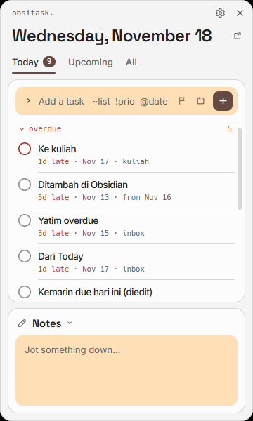

Lapisan: panel `#f4f4f4` · kartu `#fcfcfc` · kolom `#ffdfb5` · popover `#fcfcfc` — urutan benar.

| Pasangan | Depan / latar | Rasio | Batas | Hasil | Penyesuaian |
|---|---|---|---|---|---|
| Teks utama di kartu | `#202020` / `#fcfcfc` | 15.88 | 4.5 | lulus | — |
| Teks utama di kolom | `#202020` / `#ffdfb5` | 12.78 | 4.5 | lulus | — |
| Teks redup (muted) di kartu | `#646464` / `#fcfcfc` | 5.77 | 4.5 | lulus | — |
| Teks redup di kolom | `#646464` / `#ffdfb5` | 4.64 | 4.5 | lulus | — |
| Teks samar di kartu (Completed, tanggal, No tasks.) | `#666666` / `#fcfcfc` | 5.60 | 4.5 | lulus | faint: #7b7b7b → #666666 |
| Teks samar di kolom | `#666666` / `#ffdfb5` | 4.50 | 4.5 | lulus | faint: #7b7b7b → #666666 |
| Placeholder di kartu | `#666666` / `#fcfcfc` | 5.60 | 4.5 | lulus | placeholder: #7b7b7b → #666666 |
| Placeholder di kolom (bar tambah, Notes) | `#666666` / `#ffdfb5` | 4.50 | 4.5 | lulus | placeholder: #7b7b7b → #666666 |
| Judul di panel (teks besar) | `#202020` / `#f4f4f4` | 14.81 | 3 | lulus | — |
| Tab tidak aktif di panel | `#646464` / `#f4f4f4` | 5.38 | 4.5 | lulus | — |
| Teks aksen di kartu (~list, ›) | `#644a40` / `#fcfcfc` | 7.89 | 4.5 | lulus | — |
| Teks aksen di kolom | `#644a40` / `#ffdfb5` | 6.35 | 4.5 | lulus | — |
| Teks/ikon di atas aksen (badge Today, tombol +) | `#ffffff` / `#644a40` | 8.09 | 4.5 | lulus | — |
| Aksen di panel (garis tab aktif) | `#644a40` / `#f4f4f4` | 7.36 | 3 | lulus | — |
| Aksen di kartu (+ di All, checkbox selesai) | `#644a40` / `#fcfcfc` | 7.89 | 3 | lulus | — |
| Overdue / "2d late" di kartu | `#d43e22` / `#fcfcfc` | 4.54 | 4.5 | lulus | danger: #e54d2e → #d43e22 |
| Lingkaran high di kartu | `#af291f` / `#fcfcfc` | 6.48 | 3 | lulus | high: #c0392b → #af291f |
| Lingkaran medium di kartu | `#a9762a` / `#fcfcfc` | 3.85 | 3 | lulus | — |
| Lingkaran low di kartu | `#3a6ea5` / `#fcfcfc` | 5.18 | 3 | lulus | — |
| Lingkaran tanpa prioritas di kartu | `#8d8d8d` / `#fcfcfc` | 3.24 | 3 | lulus | — |

Prioritas (ΔE2000 normal / deuteranopia / protanopia; batas 20 / 12 / 12):

| Pasangan | Normal | Deutan | Protan | Hasil |
|---|---|---|---|---|
| high–medium | 28.3 | 12 | 19.8 | lulus |
| high–low | 43.7 | 53 | 44.3 | lulus |
| medium–low | 44.5 | 55.6 | 50.4 | lulus |

Semua penyesuaian:

| Token | Sumber → dipakai | Alasan |
|---|---|---|
| background | #f9f9f9 → #f4f4f4 | card not visibly lighter than panel (needs 1.07:1): panel darkened |
| faint | #7b7b7b → #666666 | faint text: 3.32 → 4.50 on card/well (needs 4.5) |
| placeholder | #7b7b7b → #666666 | placeholder: 3.32 → 4.50 on card/well (needs 4.5) |
| danger | #e54d2e → #d43e22 | overdue text: 3.77 → 4.54 on card/pop (needs 4.5) |
| tag | #2a8589 → #248084 | tag text: 4.25 → 4.55 on card (needs 4.5) |
| high | #c0392b → #af291f | priority colors too similar (normal or red-green colour blindness): lightness shifted |
